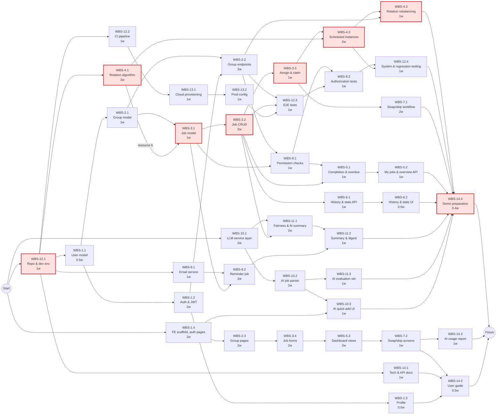
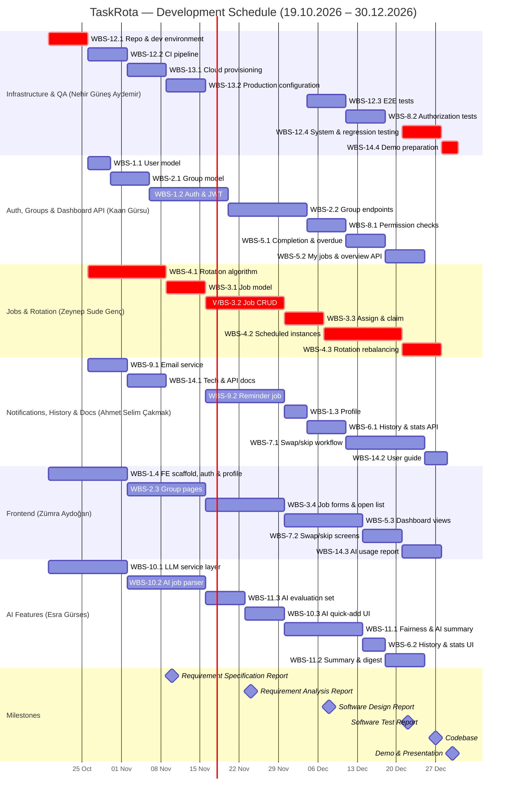

# Software Engineering — Project Plan

## Cover Page

| Field | Details |
| :---- | :---- |
| **Course** | ISE 304 — Software Engineering |
| **Report name** | Project Plan |
| **Project title** | TaskRota – Shared Job & Task Manager |
| **Group name** | TaskRota |
| **Group members** | Kaan Gürsu — 150240201, Zeynep Sude Genç — 150230204, Ahmet Selim Çakmak — 150240702, Zümra Aydoğan — 150230202, Nehir Güneş Aydemir — 150230221, Esra Gürses — 150150213 |
| **Instructor** | Abdullah Cihan Ak |
| **Submission date** | 2026-11-03 |
| **Document version** | 1.0 |
| **Repository** | [https\://github.com/AhmetSCakmak/TaskRota](https://github.com/AhmetSCakmak/TaskRota) |

---

## 1\. Introduction

### 1.1 Scope

**Project overview:**  
Groups that share responsibilities — housemates, dorms, student clubs, university project teams, volunteer groups and small offices or shops — usually divide recurring work (cleaning, opening shifts, meeting notes) through chat messages or paper lists. This makes it unclear who is responsible for what, and recurring jobs tend to fall unevenly on the same people. TaskRota is a cloud-hosted web application in which users create or join groups, define one-time and recurring jobs, see the jobs assigned to them, and mark them as done. Recurring jobs rotate fairly and automatically among group members, and members can request swaps or skips. An AI assistant lets users create jobs by describing them in plain language, categorizes jobs automatically, and produces a plain-language weekly summary of how fairly work is being shared. The system is built as a REST service (FastAPI \+ PostgreSQL) with a React frontend, developed test-first, and deployed on a cloud platform.

**In scope:**

- User registration, login and profile management (JWT authentication, bcrypt-hashed passwords)  
- Group management: create a group, join with an invite code, leave a group, owner removes a member; a user can belong to multiple groups  
- Job management: create, edit and delete jobs with title, description, due date and optional category  
- One-time jobs assigned to a specific member or claimed by a volunteer from an open job list  
- Recurring jobs (daily, weekly, monthly) with automatic fair rotation among group members  
- "My jobs" view across all groups and a group overview of the current period  
- Marking jobs as done and highlighting overdue jobs  
- Job history (who completed what and when) and contribution statistics per member  
- Swap and skip requests between group members  
- Authorization: users only view/edit jobs in their own groups and only complete jobs assigned to them  
- Email reminders for due and overdue jobs  
- **AI features:**  
  - *Natural-language job creation:* a user types e.g. "Take out the bins every Monday evening, rotate between everyone" and the AI fills in title, description, frequency, due date, category and rotation setting; the user reviews and confirms before the job is saved  
  - *Automatic job categorization:* the AI suggests a category for every new job (e.g. Cleaning, Kitchen, Admin, Shopping)  
  - *Fairness insights and weekly AI summary:* the system computes workload-balance metrics per member and the AI turns them into a short plain-language weekly summary for the group, shown in the group overview and sent in an optional weekly digest email  
- Cloud deployment of backend, frontend and database  
- Tracking and reporting of AI coding-agent usage (contributions, review time, AI-introduced errors and their fixes)

**Optional scope:**

- AI swap-partner suggestion (recommends which member is best placed to take a swapped job)  
- AI-generated checklists for a job (e.g. "Clean kitchen" → wipe counters, empty sink, take out recycling)  
- Browser push notifications in addition to email  
- Dark mode and Turkish/English localization  
- CSV export of job history

**Out of scope:**

- Native mobile applications (iOS / Android)  
- Full project-management features (Gantt charts, sprints, time tracking)  
- Payments, wages or reward systems for completed jobs  
- Shared expense and bill splitting  
- In-app chat between group members  
- Integration with external tools (Slack, Trello, Jira, calendars)  
- Third-party login (Google, Facebook, etc.)  
- Autonomous AI actions: the AI never assigns, completes or deletes jobs without user confirmation, and the rotation itself stays rule-based  
- Training or fine-tuning our own machine-learning models (a hosted LLM API is used)

**Assumptions and constraints:**

- **Team:** six members (a–f). Member f joined after the charter was approved and owns the AI features.  
- **Time:** development runs from 19.10.2026 to 30.12.2026 (codebase due 27.12.2026, demo and presentation 30.12.2026). Each member is assumed to spend about 0.5 FTE (\~20 h/week) on the activities in this plan; writing the course reports (requirements, analysis, design, test) happens in addition to this and is not part of the WBS.  
- **Technology:** fixed by the charter — Python/FastAPI, PostgreSQL, SQLAlchemy/Alembic, APScheduler, pytest, Docker, GitHub Actions, Render or Railway, React/TypeScript/Vite/Tailwind, Vitest. Added for the AI features: a hosted LLM API (e.g. Anthropic Claude or OpenAI) accessed through a provider-independent service layer, with JSON-schema (Pydantic) validation of model output.  
- **Budget:** free or student tiers for hosting and email; LLM API usage capped by a small team-agreed monthly budget limit with rate limiting in the backend.  
- **Process:** test-first development; every change goes through a pull request with CI passing; AI coding-agent contributions are labeled in GitHub issues/PRs.  
- **Privacy:** only job titles, descriptions, categories and member first names are sent to the LLM; no emails, passwords or tokens.

### 1.2 Deliverables

| Deliverable ID | Deliverable name | Description / contents | Acceptance criterion |
| :---- | :---- | :---- | :---- |
| D-01 | Backend REST API service | FastAPI application implementing authentication, groups, jobs, rotation, completion, history/statistics, swap/skip, reminders, authorization and AI endpoints | All endpoints documented in the OpenAPI spec; all unit and integration tests pass in CI; responds correctly in the deployed environment |
| D-02 | Frontend web application | React \+ TypeScript single-page app: auth and profile pages, group pages, job forms, AI quick-add, "My jobs", group overview, history/statistics, swap/skip screens | All in-scope user flows can be completed in the browser against the deployed backend; Vitest/RTL tests pass; usable on desktop and mobile widths |
| D-03 | Database schema and migrations | PostgreSQL schema (users, groups, memberships, jobs, job instances, rotations, requests, reminders, AI summaries) with Alembic migrations | Migrations run from an empty database to the latest version without errors; schema supports all functional tasks |
| D-04 | AI assistant module | LLM service layer, natural-language job parser, auto-categorizer, fairness metrics and weekly AI summary generator, evaluation dataset | Parser reaches ≥85% field-level accuracy on the evaluation set; every AI suggestion requires user confirmation; the app keeps working when the LLM is unavailable |
| D-05 | Automated test suite and CI pipeline | pytest and Vitest suites, end-to-end tests, authorization tests, GitHub Actions workflow with coverage reporting | CI runs on every pull request; main branch is green; backend line coverage ≥80% |
| D-06 | Cloud deployment | Production environment on Render/Railway: database, backend, frontend, scheduler, secrets configuration | Application reachable via public HTTPS URL; scheduled rotation and reminders run in production; smoke tests pass |
| D-07 | Documentation | Technical and API documentation, user guide, AI usage and AI-error log report, demo script | Documents complete and stored in the repository; AI usage report covers every labeled AI contribution |

### 1.3 Functional Requirements / Tasks

| Task ID | Functional requirement / task | Description | Related deliverable ID(s) |
| :---- | :---- | :---- | :---- |
| T-01 | User authentication and profile | Users register, log in (JWT), log out, and view/edit their profile; passwords stored as bcrypt hashes | D-01, D-02, D-03 |
| T-02 | Group management | Users create groups, join with an invite code, leave groups; owners remove members; users can belong to multiple groups | D-01, D-02, D-03 |
| T-03 | Job management and assignment | Create, edit and delete jobs (title, description, due date, category); one-time jobs are assigned to a member or claimed from the open job list | D-01, D-02, D-03 |
| T-04 | Recurring jobs and fair rotation | Jobs repeat daily/weekly/monthly; the system generates job instances each period and rotates the assignee fairly, rebalancing when members join or leave | D-01, D-03 |
| T-05 | Job views, completion and overdue tracking | "My jobs" across all groups, group overview of the current period, marking jobs as done, highlighting overdue jobs | D-01, D-02 |
| T-06 | Job history and contribution statistics | Record who completed which job and when; show per-member contribution statistics | D-01, D-02 |
| T-07 | Swap and skip requests | A member requests to swap a job with another member or skip a turn; the other member (or group owner) accepts or rejects | D-01, D-02, D-03 |
| T-08 | Authorization | Users only access jobs of groups they belong to and only complete jobs assigned to them; owner-only actions are protected | D-01, D-05 |
| T-09 | Email reminders | Automatic emails for jobs that are due soon and jobs that are overdue | D-01 |
| T-10 | AI natural-language job creation and categorization | Users describe a job in plain language; the AI returns a structured job draft (title, description, frequency, due date, category, rotation) for review; categories are suggested automatically | D-04, D-01, D-02 |
| T-11 | AI fairness insights and weekly summary | Workload-balance metrics per member and an AI-written weekly group summary in the group overview and an optional digest email | D-04, D-01, D-02 |
| T-12 | Test infrastructure and CI | Repository, Docker development environment, CI pipeline, end-to-end and regression testing | D-05 |
| T-13 | Cloud deployment | Provisioning and configuring the production environment, continuous deployment from main | D-06 |
| T-14 | Documentation and AI usage reporting | Technical/API docs, user guide, AI usage and AI-error log, demo preparation | D-07 |

### 1.4 Non-functional Issues

| Quality attribute | Requirement / concern | How it will be assessed |
| :---- | :---- | :---- |
| Security | JWT authentication with expiring tokens; bcrypt password hashing; HTTPS only; group-membership and assignee checks on every job endpoint; secrets only in environment variables; input validation with Pydantic; no personal data (emails, passwords) sent to the LLM; LLM output is validated against a schema and never executed | Dedicated authorization test suite (cross-group access attempts, completing other members' jobs); `pip-audit` / `npm audit` in CI; manual OWASP Top 10 checklist review before release |
| Performance | p95 response time \< 500 ms for non-AI endpoints with 50 concurrent users; AI parse request \< 5 s with a hard timeout; scheduler generates a period's job instances for 100 groups in \< 1 min | Load test with Locust against the deployed backend; timing logs for AI calls and scheduler runs |
| Usability | Creating a job takes under 1 minute (under 20 s with AI quick-add); responsive layout down to 360 px width; clear overdue highlighting; basic WCAG 2.1 AA (contrast, labels, keyboard navigation) | Task-based usability test with 5 users from the target groups; Lighthouse accessibility score ≥ 90 |
| Reliability | Scheduler is idempotent (no duplicate job instances after restarts); failed reminder emails are retried; if the LLM is slow or unavailable, users fall back to the normal job form and the weekly summary falls back to plain metrics; daily database backups from the hosting provider | Tests that run the scheduler twice and after simulated restarts; tests with a mocked failing LLM; uptime monitoring of the deployed app |
| Maintainability / testability | Test-first development; backend coverage ≥ 80%; layered architecture (routers → services → repositories); LLM provider hidden behind one interface | Coverage report in CI; code review checklist on every pull request |
| AI quality and transparency | Natural-language parser ≥ 85% field-level accuracy; AI-generated content is clearly labeled in the UI; every AI suggestion needs user confirmation; AI coding-agent contributions are tracked | Evaluation set of 50+ example job descriptions run in CI; UI review; GitHub labels and AI-error log |

---

## 2\. Project Plan — Work Breakdown Structure (WBS)

**T \= Tiny · S \= Small · M \= Medium · L \= Large · XL \= Extra-large**

| WBS activity ID | Parent task ID | Activity / subtask | Description / completion condition | Size (T/S/M/L/XL) |
| :---- | :---- | :---- | :---- | :---- |
| WBS-1.1 | T-01 | User data model | User table and Alembic migration with tests; done when migration runs and model tests pass | T |
| WBS-1.2 | T-01 | Registration, login and JWT | Register/login/logout endpoints, bcrypt hashing, token issue and validation, test-first; done when auth tests pass in CI | M |
| WBS-1.3 | T-01 | Profile management | View/edit profile and change password endpoints; done when endpoint tests pass | T |
| WBS-1.4 | T-01 | Frontend scaffold, auth and profile pages | Vite/React/Tailwind scaffold, routing, API client, login/register/profile pages; done when a user can register, log in and edit the profile in the browser | M |
| WBS-2.1 | T-02 | Group and membership data model | Group, membership and invite-code tables and migration; done when model tests pass | S |
| WBS-2.2 | T-02 | Group endpoints | Create, join by invite code, leave, remove member (owner only), list my groups; done when endpoint tests pass | M |
| WBS-2.3 | T-02 | Frontend group pages | Create/join group screens, member list, invite code sharing, leave/remove actions; done when flows work against the API | M |
| WBS-3.1 | T-03 | Job data model | Job, job-instance and category tables (one-time and recurring) and migration; done when model tests pass | S |
| WBS-3.2 | T-03 | Job CRUD endpoints | Create, edit, delete, list jobs per group with validation; done when endpoint tests pass | M |
| WBS-3.3 | T-03 | Assignment and claiming | Assign a one-time job to a member; open job list; claim a job; done when assignment tests pass | S |
| WBS-3.4 | T-03 | Frontend job forms and open job list | Create/edit job form, job detail, open-jobs list with claim button; done when flows work against the API | M |
| WBS-4.1 | T-04 | Fair rotation algorithm | Design and implement the rotation order (least-recently-assigned with tie-breaking) as a pure function with unit tests; done when all rotation scenarios pass | M |
| WBS-4.2 | T-04 | Scheduled instance generation | APScheduler job that creates each period's instances and assigns members using WBS-4.1; idempotent; done when scheduler tests pass | M |
| WBS-4.3 | T-04 | Rotation rebalancing on membership change | Adjust rotation when members join/leave or are removed; done when rebalancing tests pass | S |
| WBS-5.1 | T-05 | Completion and overdue logic | Mark-as-done endpoint (assignee only), overdue detection; done when tests pass | S |
| WBS-5.2 | T-05 | "My jobs" and group overview endpoints | Aggregated jobs across groups; current-period overview per group; done when tests pass | S |
| WBS-5.3 | T-05 | Frontend dashboard views | "My jobs" page, group overview page, done button, overdue highlighting; done when views show live data | M |
| WBS-6.1 | T-06 | History and statistics endpoints | Completion history and per-member contribution counts; done when tests pass | S |
| WBS-6.2 | T-06 | Frontend history and statistics | History list and simple contribution charts; done when shown in group overview | T |
| WBS-7.1 | T-07 | Swap and skip request workflow | Request, accept, reject, cancel; reassignment and rotation update; done when workflow tests pass | M |
| WBS-7.2 | T-07 | Frontend swap/skip screens | Request dialog and incoming-requests list; done when the flow works end to end | S |
| WBS-8.1 | T-08 | Permission checks | Reusable FastAPI dependencies for membership, owner and assignee checks applied to all endpoints; done when all routes are protected | S |
| WBS-8.2 | T-08 | Authorization test suite | Negative tests for cross-group access and unauthorized actions; done when the suite passes in CI | S |
| WBS-9.1 | T-09 | Email service integration | SMTP/SendGrid client, email templates, sandbox mode for tests; done when a test email is delivered | S |
| WBS-9.2 | T-09 | Due and overdue reminder job | Scheduled reminders with retry and per-user opt-out; done when scheduler tests pass and emails arrive in staging | M |
| WBS-10.1 | T-10 | LLM service layer | Provider-independent client, prompt templates, JSON-schema output validation, timeouts, rate limit, fallback; done when unit tests with a mocked LLM pass | M |
| WBS-10.2 | T-10 | Job-parsing and categorization endpoint | Endpoint that turns free text into a validated job draft and suggests a category; done when evaluation and endpoint tests pass | M |
| WBS-10.3 | T-10 | Frontend AI quick-add | Text box, editable preview of the AI draft, confirm/edit/cancel; done when a job can be created from a sentence | S |
| WBS-11.1 | T-11 | Fairness metrics and AI weekly summary | Workload-balance metrics per member and AI-generated summary text, stored per week; done when tests pass with a mocked LLM | M |
| WBS-11.2 | T-11 | Summary display and weekly digest | AI summary card in group overview and optional weekly digest email; done when shown and sent in staging | S |
| WBS-11.3 | T-11 | AI evaluation set and quality checks | 50+ labeled job descriptions and summary checks run in CI; done when accuracy is reported automatically | S |
| WBS-12.1 | T-12 | Repository and dev environment | Repo structure, Docker Compose (API, DB), branch rules, issue labels incl. AI labels; done when every member can run the stack locally | S |
| WBS-12.2 | T-12 | CI pipeline | GitHub Actions: lint, pytest, Vitest, coverage, dependency audit; done when CI runs on every PR | S |
| WBS-12.3 | T-12 | End-to-end tests for core flows | E2E tests for register → group → job → complete; done when they run in CI | S |
| WBS-12.4 | T-12 | System and regression testing | Full regression, load and usability test runs on the release candidate; done when results are recorded and blocking bugs fixed | S |
| WBS-13.1 | T-13 | Cloud provisioning | Database, backend, scheduler worker and frontend on Render/Railway; continuous deployment from main; done when the app is reachable over HTTPS | S |
| WBS-13.2 | T-13 | Production configuration | Secrets, environment variables, backups, logging and uptime monitoring, smoke tests; done when smoke tests pass after each deploy | S |
| WBS-14.1 | T-14 | Technical and API documentation | Architecture overview, setup guide, OpenAPI conventions (kept up to date); done when a new member can set up the project from the docs | S |
| WBS-14.2 | T-14 | User guide | Short guide with screenshots for all main flows; done when reviewed by the team | T |
| WBS-14.3 | T-14 | AI usage and AI-error report | Compile AI contribution labels, effort and review time, and the log of AI-introduced errors with detection and fixes; done when every labeled item is covered | S |
| WBS-14.4 | T-14 | Demo preparation | Demo data, demo script and rehearsal; done after one full rehearsal | T |

**WBS decomposition notes:**  
Each functional task was split by layer (data model → backend endpoints → frontend) because this matches team roles and allows test-first work at each layer. The frontend is developed against the agreed OpenAPI contract with mocked responses, so it can start before the matching backend endpoints are finished; real integration is verified in WBS-12.3 and WBS-12.4. The fair rotation algorithm (WBS-4.1) is a pure function with no database dependency, so it can start as soon as the repository exists. The AI features were kept separate from core rotation logic: the AI only suggests and summarizes, while assignment stays rule-based and testable. The LLM service layer (WBS-10.1) is prototyped in week 1 and merged once the repository is ready. Course report writing is not part of the WBS.

> **Course guideline note:** User stories for these subtasks will be written in the separate requirements document; this project plan defines and sizes the subtasks.

---

## 3\. Estimates

| WBS activity ID | Size | Estimated effort (man-weeks) | Basis / assumptions |
| :---- | :---- | :---- | :---- |
| WBS-1.1 | T | 0.25 | Single table, standard pattern |
| WBS-1.2 | M | 1.0 | JWT and hashing setup plus thorough tests; security-critical |
| WBS-1.3 | T | 0.25 | Simple CRUD on existing model |
| WBS-1.4 | M | 1.0 | Includes project scaffold and API client in addition to pages |
| WBS-2.1 | S | 0.5 | Three related tables and invite-code generation |
| WBS-2.2 | M | 1.0 | Five endpoints with owner rules and edge cases |
| WBS-2.3 | M | 1.0 | Several screens and state handling |
| WBS-3.1 | S | 0.5 | Must support both one-time and recurring jobs |
| WBS-3.2 | M | 1.0 | Full CRUD with validation and filtering |
| WBS-3.3 | S | 0.5 | Small state machine (open → claimed/assigned) |
| WBS-3.4 | M | 1.0 | Largest form in the app, date and frequency inputs |
| WBS-4.1 | M | 1.0 | Algorithm design plus many edge-case tests |
| WBS-4.2 | M | 1.0 | Scheduling, idempotency and time-zone handling |
| WBS-4.3 | S | 0.5 | Builds on WBS-4.1 |
| WBS-5.1 | S | 0.5 | Small logic, needs permission checks |
| WBS-5.2 | S | 0.5 | Aggregation queries |
| WBS-5.3 | M | 1.0 | Two main dashboard pages |
| WBS-6.1 | S | 0.5 | Queries over completion records |
| WBS-6.2 | T | 0.25 | Simple list and chart with an existing library |
| WBS-7.1 | M | 1.0 | Multi-step workflow interacting with rotation |
| WBS-7.2 | S | 0.5 | Dialog and request list |
| WBS-8.1 | S | 0.5 | Reusable dependencies applied across routers |
| WBS-8.2 | S | 0.5 | Negative tests for each protected route |
| WBS-9.1 | S | 0.5 | Provider SDK integration and templates |
| WBS-9.2 | M | 1.0 | Scheduling, retries and opt-out |
| WBS-10.1 | M | 1.0 | Prompt design, schema validation and failure handling; new technology for the team |
| WBS-10.2 | M | 1.0 | Date/frequency interpretation and categorization need iteration |
| WBS-10.3 | S | 0.5 | One component with preview and edit |
| WBS-11.1 | M | 1.0 | Metric definition plus summary prompt and storage |
| WBS-11.2 | S | 0.5 | Reuses email service and overview page |
| WBS-11.3 | S | 0.5 | Writing and labeling examples, CI script |
| WBS-12.1 | S | 0.5 | Standard setup |
| WBS-12.2 | S | 0.5 | Standard GitHub Actions workflow |
| WBS-12.3 | S | 0.5 | A few critical flows only |
| WBS-12.4 | S | 0.5 | Runs existing suites plus load and usability tests |
| WBS-13.1 | S | 0.5 | Managed platform, mostly configuration |
| WBS-13.2 | S | 0.5 | Secrets, backups, monitoring |
| WBS-14.1 | S | 0.5 | Architecture and setup docs; OpenAPI is generated |
| WBS-14.2 | T | 0.25 | Short guide |
| WBS-14.3 | S | 0.5 | Compiling data collected throughout the project |
| WBS-14.4 | T | 0.25 | Script and one rehearsal |
| **Total** | — | **26.25** | — |

**Estimation method:**  
Each activity was sized by the team using T-shirt sizing based on the number of endpoints/screens, algorithmic complexity, and how new the technology is to the team. Sizes were converted with a fixed scale: **T \= 0.25, S \= 0.5, M \= 1, L \= 2, XL \= 3 man-weeks**. No activity was sized L or XL; larger pieces of work were split further instead. Effort includes writing tests first, implementation and code review (including review of AI-generated code). Available capacity is 6 members × 0.5 FTE × \~10 weeks ≈ 30 man-weeks, so the 26.25 man-week plan leaves about 12% buffer.

**Effort versus duration:** At 0.5 FTE, 1 man-week of effort takes 2 calendar weeks for one member. So T ≈ 0.5 week (4 days), S \= 1 week, M \= 2 weeks.

---

## 4\. Resources

### 4.1 Team Structure and Member Roles

| Member | Student ID | Role(s) | Main responsibilities |
| :---- | :---- | :---- | :---- |
| Kaan Gürsu | 150240201 | Project Manager / Backend Developer (Authentication & Groups) | Planning and tracking, weekly meetings, authentication, groups, permission checks, completion and dashboard endpoints |
| Zeynep Sude Genç | 150230204 | Customer Meeting & Requirements Lead / Backend Developer (Jobs, Scheduling & Rotation) | Customer communication with the product owner, job model and CRUD, assignment, rotation algorithm, scheduler |
| Ahmet Selim Çakmak | 150240702 | Documentation Lead / Backend Developer (Notifications & Reminders) | Report coordination, technical docs and user guide, email reminders, profile, history/statistics, swap/skip workflow |
| Zümra Aydoğan | 150230202 | AI Usage Reporting Lead / Frontend Developer | Frontend architecture and main pages, AI coding-agent usage tracking and AI-error report |
| Nehir Güneş Aydemir | 150230221 | QA Lead / DevOps (Database, CI/CD, Deployment, Testing) | Repository and Docker setup, CI/CD, cloud deployment, E2E, authorization and regression testing, demo setup |
| Esra Gürses | 150150213 | AI Features Developer (new member) | LLM service layer, natural-language job creation and categorization, fairness insights and weekly AI summary, AI evaluation set, AI-related frontend components |

4.2 Member-to-Activity Assignment

| WBS activity ID | Assigned member | Responsibility | Allocation to activity (FTE) |
| :---- | :---- | :---- | :---- |
| WBS-1.1 | Kaan Gürsu | User model and migration | 0.5 |
| WBS-1.2 | Kaan Gürsu | Auth endpoints and tests | 0.5 |
| WBS-1.3 | Ahmet Selim Çakmak | Profile endpoints | 0.5 |
| WBS-1.4 | Zümra Aydoğan | Frontend scaffold, auth and profile pages | 0.5 |
| WBS-2.1 | Kaan Gürsu | Group/membership model | 0.5 |
| WBS-2.2 | Kaan Gürsu | Group endpoints | 0.5 |
| WBS-2.3 | Zümra Aydoğan | Group pages | 0.5 |
| WBS-3.1 | Zeynep Sude Genç | Job model | 0.5 |
| WBS-3.2 | Zeynep Sude Genç | Job CRUD endpoints | 0.5 |
| WBS-3.3 | Zeynep Sude Genç | Assignment and claiming | 0.5 |
| WBS-3.4 | Zümra Aydoğan | Job forms and open job list | 0.5 |
| WBS-4.1 | Zeynep Sude Genç | Rotation algorithm | 0.5 |
| WBS-4.2 | Zeynep Sude Genç | Scheduled instance generation | 0.5 |
| WBS-4.3 | Zeynep Sude Genç | Rotation rebalancing | 0.5 |
| WBS-5.1 | Kaan Gürsu | Completion and overdue logic | 0.5 |
| WBS-5.2 | Kaan Gürsu | "My jobs" and overview endpoints | 0.5 |
| WBS-5.3 | Zümra Aydoğan | Dashboard views | 0.5 |
| WBS-6.1 | Ahmet Selim Çakmak | History and statistics endpoints | 0.5 |
| WBS-6.2 | Esra Gürses | History and statistics UI | 0.5 |
| WBS-7.1 | Ahmet Selim Çakmak | Swap/skip workflow | 0.5 |
| WBS-7.2 | Zümra Aydoğan | Swap/skip screens | 0.5 |
| WBS-8.1 | Kaan Gürsu | Permission dependencies | 0.5 |
| WBS-8.2 | Nehir Güneş Aydemir | Authorization test suite | 0.5 |
| WBS-9.1 | Ahmet Selim Çakmak | Email service integration | 0.5 |
| WBS-9.2 | Ahmet Selim Çakmak | Reminder scheduler job | 0.5 |
| WBS-10.1 | Esra Gürses | LLM service layer | 0.5 |
| WBS-10.2 | Esra Gürses | Job-parsing and categorization endpoint | 0.5 |
| WBS-10.3 | Esra Gürses | AI quick-add component | 0.5 |
| WBS-11.1 | Esra Gürses | Fairness metrics and AI summary | 0.5 |
| WBS-11.2 | Esra Gürses | Summary display and digest email | 0.5 |
| WBS-11.3 | Esra Gürses | AI evaluation set | 0.5 |
| WBS-12.1 | Nehir Güneş Aydemir | Repository and Docker setup | 0.5 |
| WBS-12.2 | Nehir Güneş Aydemir | CI pipeline | 0.5 |
| WBS-12.3 | Nehir Güneş Aydemir | End-to-end tests | 0.5 |
| WBS-12.4 | Nehir Güneş Aydemir | System and regression testing | 0.5 |
| WBS-13.1 | Nehir Güneş Aydemir | Cloud provisioning | 0.5 |
| WBS-13.2 | Nehir Güneş Aydemir | Production configuration | 0.5 |
| WBS-14.1 | Ahmet Selim Çakmak | Technical and API documentation | 0.5 |
| WBS-14.2 | Ahmet Selim Çakmak | User guide | 0.5 |
| WBS-14.3 | Zümra Aydoğan | AI usage and AI-error report (all members log their AI usage throughout) | 0.5 |
| WBS-14.4 | Nehir Güneş Aydemir | Demo preparation (lead; all members join the rehearsal) | 0.5 |

**Total effort per member:** Kaan Gürsu 4.25 · Zeynep Sude Genç 4.5 · Ahmet Selim Çakmak 4.0 · Zümra Aydoğan 5.0 · Nehir Güneş Aydemir 3.75 · Esra Gürses 4.75 man-weeks (sum 26.25).

**Availability or allocation constraints:**  
All members are students with other courses, so each is allocated 0.5 FTE (\~20 h/week) to this plan, and no member works on two activities at the same time. Report deadlines (10.11, 24.11, 08.12, 22.12) and end-of-term exams reduce availability in those weeks; Nehir Güneş Aydemir's free weeks (16.11–03.12) and Ahmet Selim Çakmak's free week (09.11–15.11) are reserved for report writing and code review. Esra Gürses joined after the charter, so Esra Gürses's first week includes onboarding alongside the LLM prototype. Zeynep Sude Genç carries the critical path and must be protected from extra assignments (see R-09).

---

## 5\. Schedule

### 5.1 PERT Chart — Activity Sequence

Durations are calendar weeks at 0.5 FTE. Critical-path activities are highlighted in red.

&nbsp;

**PERT notes (activity durations and dependencies):**  
Durations come from Section 3 at 0.5 FTE (1 man-week \= 2 calendar weeks). Three streams start in parallel in week 1: infrastructure (WBS-12.1), the frontend scaffold (WBS-1.4, built against the agreed API contract with mocks), and the LLM prototype (WBS-10.1). The backend then splits into an auth/groups stream (Kaan Gürsu), a jobs/rotation stream (Zeynep Sude Genç), and a notifications/history/swap stream (Ahmet Selim Çakmak). The link WBS-4.1 → WBS-3.1 is a **resource dependency**: both are done by Zeynep Sude Genç, and Zeynep Sude Genç starts with the rotation algorithm because it needs no database. All logical dependencies are data-model or service dependencies (e.g. job endpoints need the job model, rotation needs the assignment service). Every feature must be finished before demo preparation (WBS-14.4).

### 5.2 Critical Path and Total Project Duration

**Critical path (in activity order):**  
`WBS-12.1 → WBS-4.1 → WBS-3.1 → WBS-3.2 → WBS-3.3 → WBS-4.2 → WBS-4.3 → WBS-14.4`

| Critical-path activity ID | Duration (weeks) | Reason it is critical |
| :---- | :---- | :---- |
| WBS-12.1 | 1 | Every development activity needs the repository and dev environment |
| WBS-4.1 | 2 | Needed by WBS-4.2; occupies member b before the job model can start |
| WBS-3.1 | 1 | Job model is needed by job CRUD, reminders, permissions and AI insights |
| WBS-3.2 | 2 | Job CRUD is needed by assignment, completion, history, E2E tests and AI insights |
| WBS-3.3 | 1 | Assignment service is used by rotation and swap/skip |
| WBS-4.2 | 2 | Recurring instance generation is the core feature; regression testing depends on it |
| WBS-4.3 | 1 | Last rotation feature; ends exactly at the codebase deadline (27.12) |
| WBS-14.4 | 0.4 (3 days) | Demo can only be prepared once all features are complete |
| **Total** | **≈ 10.4** | — |

**Total project schedule:** **≈ 10.4 weeks (72 calendar days)**, from **2026-10-19** to **2026-12-30**.

**Critical-path explanation:**  
Forward and backward passes over the PERT network show that the jobs-and-rotation chain owned by member b has zero slack: it starts after the repository is ready (25.10), runs without gaps until 27.12, and demo preparation fills 28.12–30.12. WBS-12.4 (system and regression testing, 21.12–27.12) runs in parallel to WBS-4.3 and is also effectively critical. Near-critical chains have 3 days of slack: the frontend chain (Zümra Aydoğan, ends 27.12 with the AI usage report) and the AI chain (Esra Gürses, ends 24.12). The auth/groups chain (Kaan Gürsu) ends 24.12, and the documentation/notifications chain (Ahmet Selim Çakmak) ends 28.12. Any delay on b's chain directly delays the codebase deadline, so the team watches it at every weekly meeting (see R-09).

### 5.3 Gantt Chart — Project Timeline

&nbsp;

**Schedule consistency check:**

- **Effort ↔ duration:** every bar equals effort ÷ 0.5 FTE (T \= 4 days, S \= 7 days, M \= 14 days); WBS-14.4 is compressed to 3 days because the whole team joins the rehearsal.  
- **Estimates ↔ resources:** the per-member totals in Section 4.2 (Kaan Gürsu 4.25, Zeynep Sude Genç 4.5, Ahmet Selim Çakmak 4.0, Zümra Aydoğan 5.0, Nehir Güneş Aydemir 3.75, Esra Gürses 4.75) add up to the 26.25 man-week total in Section 3\.  
- **Availability:** no member has two overlapping activities, so nobody exceeds 0.5 FTE in any week.  
- **Dependencies:** every activity in the Gantt chart starts on or after the finish of all its PERT predecessors; the only resource-driven link (WBS-4.1 → WBS-3.1) is marked in the PERT chart.  
- **Deadlines:** all development activities finish by 27.12 (codebase deadline); the user guide finishes 28.12 and demo preparation 30.12, matching the charter milestones.  
- **Critical path:** the red bars in the Gantt chart match the critical path in Section 5.2 and the highlighted PERT nodes.

---

## 6\. Risks

### 6.1 Risk Impact / Probability Chart

**Risk register** (ascending order of probability, then impact):

| Risk ID | Risk description | Probability (1–5) | Impact (1–5) | Risk score (P × I) | Affected WBS activity ID(s) |
| :---- | :---- | :---- | :---- | :---- | :---- |
| R-01 | Email provider limits, spam filtering or delivery failures stop reminders from arriving | 2 | 2 | 4 | WBS-9.1, WBS-9.2, WBS-11.2 |
| R-02 | A team member becomes unavailable for a long period (illness, dropping the course) | 2 | 4 | 8 | All activities of that member |
| R-03 | Private group data leaks to the LLM provider, or prompt injection through job text makes the AI produce misleading output | 2 | 4 | 8 | WBS-10.1, WBS-10.2, WBS-11.1 |
| R-04 | An authorization flaw lets users see or change jobs in groups they don't belong to | 2 | 5 | 10 | WBS-8.1, WBS-8.2, WBS-1.2, WBS-2.2 |
| R-05 | Free-tier hosting limits (sleeping services, DB size, no background workers) break the scheduler or the demo | 3 | 3 | 9 | WBS-13.1, WBS-13.2, WBS-4.2, WBS-9.2 |
| R-06 | LLM API cost, rate limits or outages make AI features unavailable | 3 | 3 | 9 | WBS-10.1, WBS-10.2, WBS-11.1 |
| R-07 | Frontend and backend drift from the agreed API contract, causing late integration problems | 3 | 3 | 9 | WBS-1.4, WBS-2.3, WBS-3.4, WBS-5.3, WBS-12.3 |
| R-08 | The new member (f) needs extra onboarding time, delaying the AI stream | 3 | 3 | 9 | WBS-10.1, WBS-10.2, WBS-11.1 |
| R-09 | Rotation and scheduling are harder than estimated (edge cases, time zones, membership changes) and delay the critical path | 3 | 4 | 12 | WBS-4.1, WBS-4.2, WBS-4.3, WBS-7.1 |
| R-10 | The AI parser misreads dates, frequencies or categories (hallucinated or wrong fields) | 4 | 3 | 12 | WBS-10.2, WBS-10.3, WBS-11.3 |
| R-11 | Code produced by the AI coding agent introduces subtle bugs or security issues that pass review | 4 | 3 | 12 | All development activities, WBS-14.3 |
| R-12 | Report deadlines, other courses and exams reduce available time, causing schedule overrun | 4 | 4 | 16 | All activities, especially the critical path |

&nbsp;

| Impact ↓ / Probability → | 1 (Very low) | 2 (Low) | 3 (Medium) | 4 (High) | 5 (Very high) |
| :---- | :---- | :---- | :---- | :---- | :---- |
| **1 — Very low** | — | — | — | — | — |
| **2 — Low** | — | R-01 | — | — | — |
| **3 — Medium** | — | — | R-05, R-06, R-07, R-08 | R-10, R-11 | — |
| **4 — High** | — | R-02, R-03 | R-09 | R-12 | — |
| **5 — Very high** | — | R-04 | — | — | — |

### 6.2 Risk Mitigation / Aversion Plan

| Risk ID | Related WBS activity ID(s) | Mitigation / avoidance strategy | Responsible member | Contingency if risk occurs |
| :---- | :---- | :---- | :---- | :---- |
| R-01 | WBS-9.1, WBS-9.2, WBS-11.2 | Use a transactional email provider with verified sender domain; sandbox mode in tests; retry with backoff; log every send | Ahmet Selim Çakmak | Switch to a second SMTP provider; show reminders as in-app banners on the "My jobs" page |
| R-02 | All | Pair each stream with a backup member (a↔b, c↔e, d↔f); keep docs and issues current; small pull requests | Kaan Gürsu | Re-plan the affected member's activities among the others; move lowest-priority work to optional scope |
| R-03 | WBS-10.1, WBS-10.2, WBS-11.1 | Send only job text and first names; strip emails/IDs; treat job text as data in prompts; validate all output against a strict JSON schema; per-group AI opt-out | Esra Gürses | Disable the affected AI feature with a feature flag; fall back to the manual form and plain metrics |
| R-04 | WBS-8.1, WBS-8.2, WBS-1.2, WBS-2.2 | Central permission dependencies on every router; negative authorization tests written first; security checklist in code review | Kaan Gürsu, Nehir Güneş Aydemir | Fix immediately as top priority; add a regression test for the case; re-run the full authorization suite |
| R-05 | WBS-13.1, WBS-13.2, WBS-4.2, WBS-9.2 | Deploy in week 3 so limits show up early; make scheduler jobs idempotent and catch up on missed runs at startup; uptime ping | Nehir Güneş Aydemir | Move to the other platform (Render ↔ Railway) using the Docker image; for the demo use a paid tier for one month or run a local Docker setup |
| R-06 | WBS-10.1, WBS-10.2, WBS-11.1 | Provider-independent service layer; monthly spending cap; caching of weekly summaries; rate limiting per user; timeouts | Esra Gürses | Switch to a second provider or a cheaper model; disable AI features gracefully while the core app keeps working |
| R-07 | WBS-1.4, WBS-2.3, WBS-3.4, WBS-5.3, WBS-12.3 | OpenAPI spec agreed before each feature; generate TypeScript types from the spec; E2E tests in CI from early December | Zümra Aydoğan, Nehir Güneş Aydemir | Schedule a joint integration session; fix mismatches using the spec as the single source of truth |
| R-08 | WBS-10.1, WBS-10.2, WBS-11.1 | Onboarding session and setup guide in week 1; f pairs with d (frontend) and b (job model) for the first reviews | Kaan Gürsu | Cut optional AI scope first; move WBS-6.2 (history UI) back to d if f falls behind |
| R-09 | WBS-4.1, WBS-4.2, WBS-4.3, WBS-7.1 | Start the rotation algorithm in week 2 as a pure, well-tested function; write edge-case tests first; keep b free of extra tasks; check critical-path progress weekly | Zeynep Sude Genç | a or c helps with WBS-4.3; simplify rebalancing (e.g. reset rotation order on membership change) to protect the deadline |
| R-10 | WBS-10.2, WBS-10.3, WBS-11.3 | User always sees and confirms an editable preview; dates computed in code, not by the LLM; evaluation set with ≥85% target run in CI | Esra Gürses | Lower AI scope to category suggestion and title extraction only; keep the manual form as the default |
| R-11 | All development activities, WBS-14.3 | Label AI-generated PRs; human review required for every AI change; test-first so AI code must pass tests written by members; log AI-introduced errors | Zümra Aydoğan, Nehir Güneş Aydemir | Revert the change, add a regression test, record the error and its fix in the AI-error log |
| R-12 | All, especially critical path | \~12% capacity buffer; report work scheduled in members' free weeks; weekly progress check against the Gantt chart; optional scope only after in-scope work is done | Kaan Gürsu | Move features from in-scope to optional with the product owner's agreement; temporarily raise allocation on the critical path |
