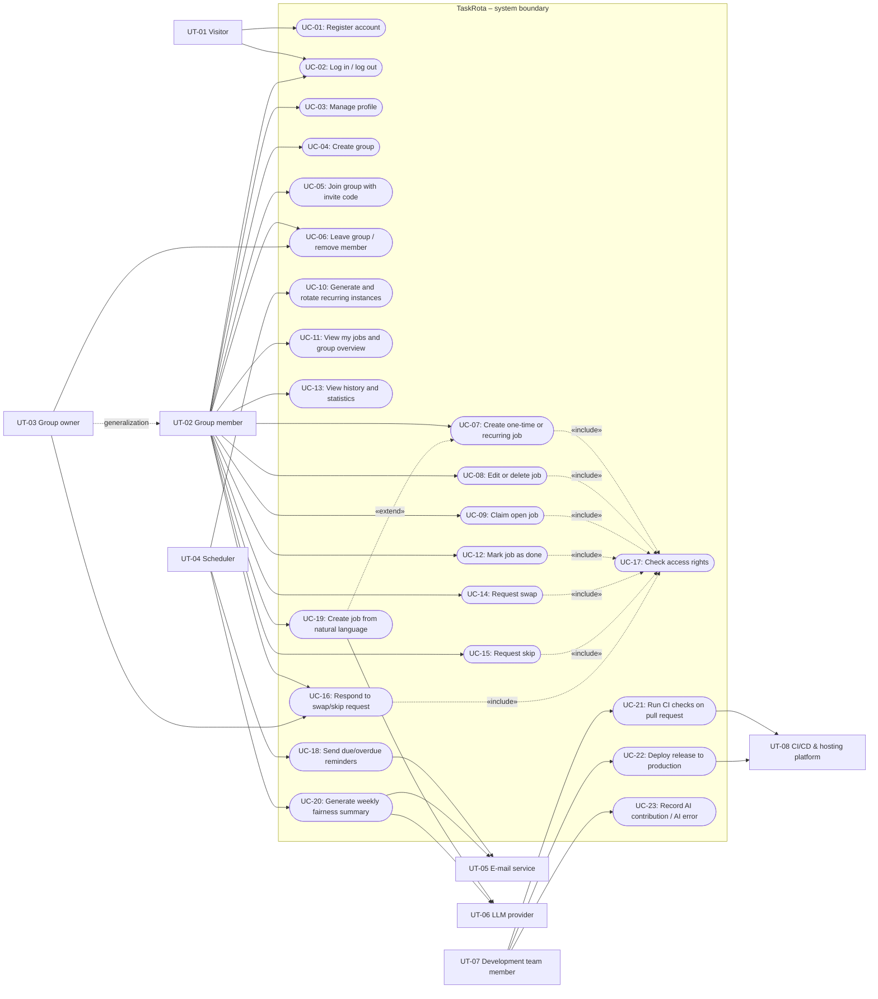
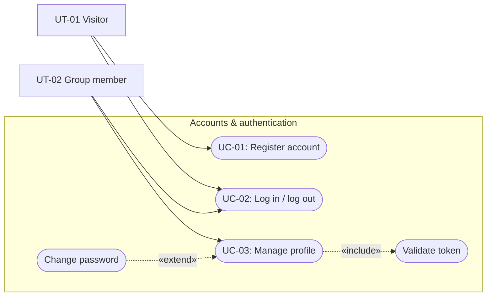
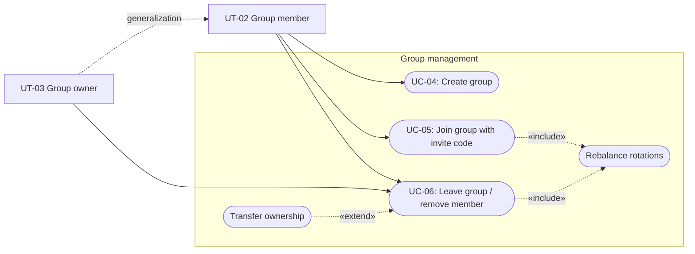
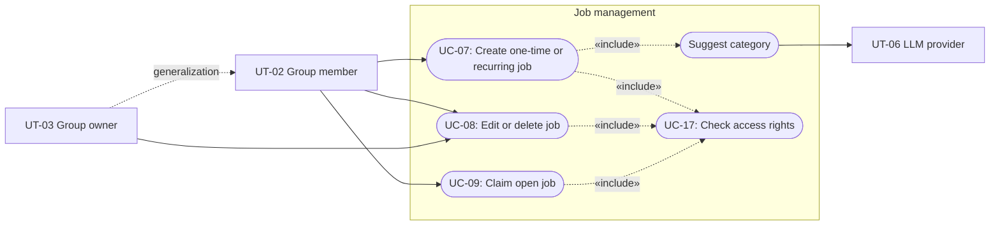
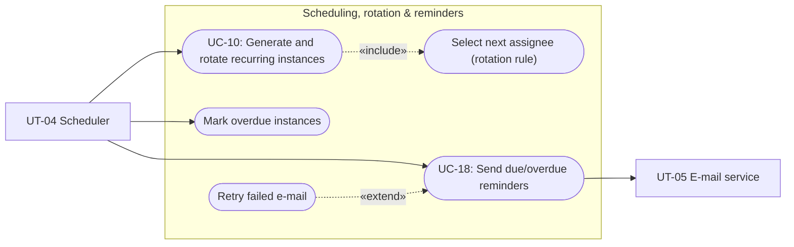
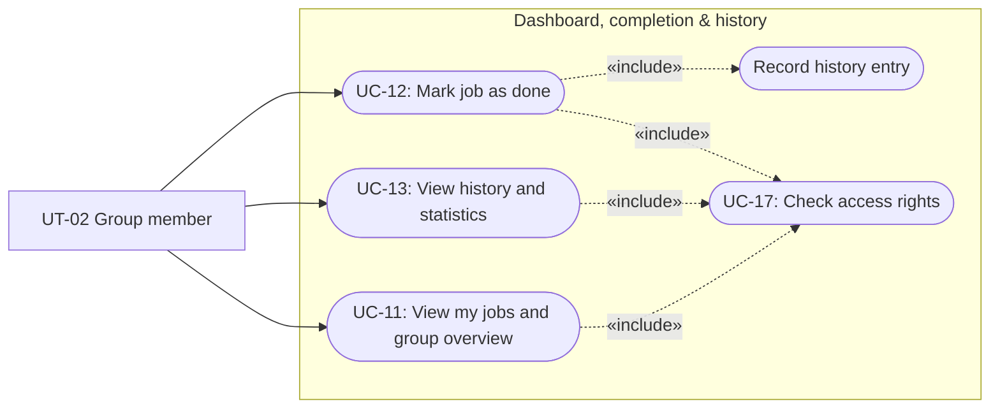
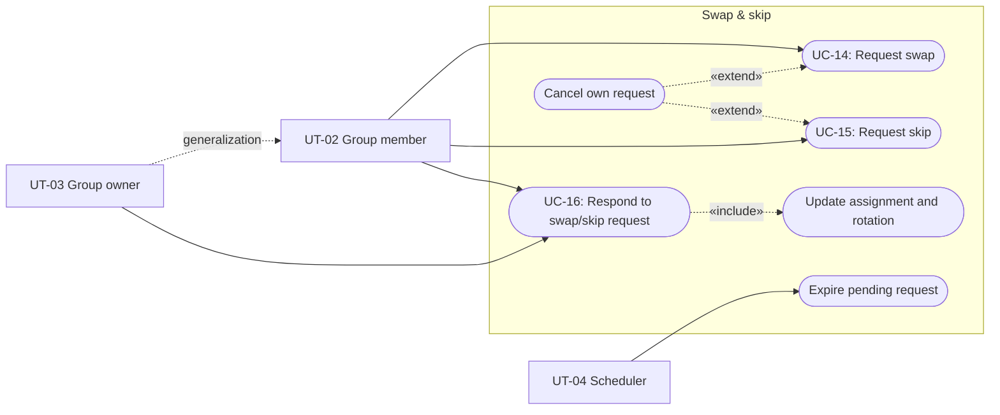
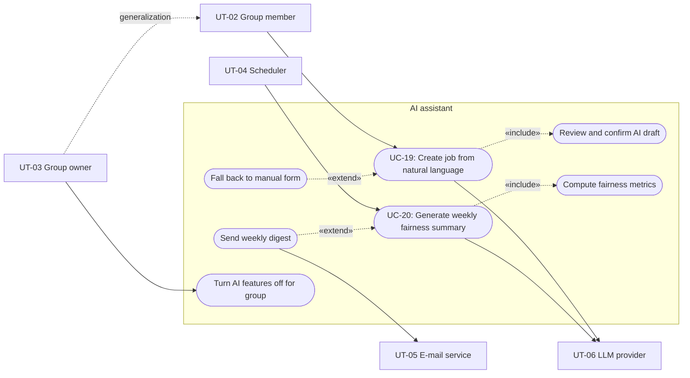
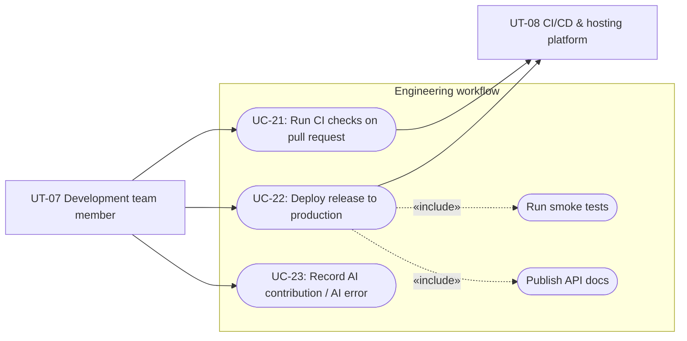

# Software Engineering — Requirements Specification

## Cover Page

| Field | Details |
|---|---|
| **Course** | ISE 304 — Software Engineering |
| **Report name** | Requirements Specification |
| **Project title** | TaskRota – Shared Job & Task Manager |
| **Group name / number** | TaskRota |
| **Group members** | Kaan Gürsu — 150240201, Zeynep Sude Genç — 150230204, Ahmet Selim Çakmak — 150240702, Zümra Aydoğan — 150230202, Nehir Güneş Aydemir — 150230221, Esra Gürses — 150150213 |
| **Instructor** | Abdullah Cihan Ak |
| **Submission date** | 2026-11-24 |
| **Document version** | 1.0 |
| **Repository** | https://github.com/AhmetSCakmak/TaskRota |

---

## 1. Introduction

**Project overview.** Groups that share responsibilities — housemates, dorms, student clubs, university project teams, volunteer groups and small offices or shops — usually divide recurring work (cleaning, opening shifts, meeting notes) through chat messages or paper lists. As a result it is often unclear who is responsible for what, and recurring jobs fall unevenly on the same people. TaskRota is a cloud-hosted web application in which users create or join groups, define one-time and recurring jobs, see the jobs assigned to them and mark them as done. Recurring jobs rotate fairly and automatically among group members, and members can request swaps or skips. An AI assistant lets users create jobs by describing them in plain language, suggests a category for every job, and writes a short weekly summary of how fairly work is being shared. The system is a REST service (Python/FastAPI, PostgreSQL) with a React/TypeScript frontend, developed test-first and deployed on Render or Railway.

**Purpose of this document.** This Requirements Specification turns the scope agreed in the **Project Charter** and the tasks (`T-01`–`T-14`), deliverables (`D-01`–`D-07`) and work-breakdown activities (`WBS-1.1`–`WBS-14.4`) of the **Project Plan (v1.0, 2026-11-03)** into verifiable functional and non-functional requirements and use cases. It is the reference for the product owner (Ahmet Selim Çakmak) and the instructor to confirm the scope, for developers to implement features test-first, and for the QA lead to derive acceptance and system tests. Optional-scope items of the Project Plan (AI swap-partner suggestion, AI checklists, push notifications, dark mode/localization, CSV export) and out-of-scope items (native mobile apps, payments, chat, external integrations, third-party login, autonomous AI actions, own model training) are **not** specified here.

**Definitions used in this document.**

| Term | Meaning |
|---|---|
| Group | A set of users who share jobs (e.g. a flat, a club). A user may belong to several groups. |
| Owner | The member who created a group (or to whom ownership was transferred); has extra management rights. |
| Job | A job definition: title, description, due date or frequency, optional category. One-time or recurring. |
| Job instance | One concrete occurrence of a job with an assignee, a due date and a status (open, assigned, done, overdue, skipped). A one-time job has exactly one instance. |
| Period | The interval of a recurring job: one day, one week or one month. |
| Rotation | The ordered list of group members who take turns on a recurring job. |
| Overdue | An instance whose due date/time has passed and whose status is not *done* or *skipped*. |
| AI draft | A structured job proposal produced by the LLM from free text; never saved without user confirmation. |

**Structure of the document.**
- **Section 2 — System Requirements:** functional requirements (`FR-01`–`FR-51`) linked to Project Plan tasks and deliverables, and non-functional requirements (`NFR-01`–`NFR-14`) with measurable verification.
- **Section 3 — Use Cases:** user types and actors (`UT-01`–`UT-08`), personas (`P-01`–`P-05`), user scenarios (`SC-01`–`SC-11`) and user stories for every WBS activity, use case diagrams for the whole system and for each major functionality, and detailed use cases (`UC-01`–`UC-23`) with alternative and exception flows, plus a coverage matrix showing that every Project Plan task is covered.

---

## 2. System Requirements

### 2.1 Functional Requirements

Priorities use MoSCoW: **Must** = required for the in-scope release, **Should** = in scope but may be simplified if the critical path is at risk (see Project Plan R-09/R-12).

| Requirement ID | Related task ID(s) | Related deliverable ID(s) | Functional requirement (natural language) | Priority | Verification / acceptance condition |
|---|---|---|---|---|---|
| FR-01 | T-01 | D-01, D-02, D-03 | The system shall allow a visitor to register an account with first name, last name, e-mail address and password, shall reject an e-mail address that is already registered, and shall store the password only as a bcrypt hash. | Must | API test: valid registration returns 201 and the user row holds a bcrypt hash, not the plain password; second registration with the same e-mail returns 409. |
| FR-02 | T-01 | D-01, D-02 | The system shall issue an expiring JWT access token when a registered user logs in with a correct e-mail and password, and shall reject wrong credentials with a message that does not reveal which field was wrong. | Must | API test: correct credentials return a token with an `exp` claim; wrong password and unknown e-mail both return 401 with the same message. |
| FR-03 | T-01 | D-01, D-02 | The system shall end the user's session when the user logs out by removing the token from the client, and shall reject requests to protected endpoints that carry a missing, malformed or expired token. | Must | E2E test: after logout, protected pages redirect to login; API test: expired/forged token returns 401. |
| FR-04 | T-01 | D-01, D-02 | The system shall allow a logged-in user to view and edit their profile (name, e-mail, e-mail reminder preferences) and to change their password after re-entering the current password. | Must | API/UI test: profile changes are persisted; password change with a wrong current password returns 400 and leaves the old password valid. |
| FR-05 | T-02 | D-01, D-02, D-03 | The system shall allow a logged-in user to create a group with a name, shall make the creator the group owner, and shall generate a unique invite code for the group. | Must | API test: new group returns an invite code; creator has role *owner*; 1,000 generated codes contain no duplicates. |
| FR-06 | T-02 | D-01, D-02 | The system shall add a logged-in user to a group as a member when the user enters a valid invite code, and shall reject invalid codes and users who are already members. | Must | API test: valid code → 200 and membership row; invalid code → 404; repeat join → 409. |
| FR-07 | T-02 | D-01, D-02 | The system shall allow a member to leave a group; an owner who is not the only member shall first transfer ownership to another member, and a group whose last member leaves shall be deleted. | Must | API test for each case: member leaves; owner blocked until transfer; last member leaving deletes the group. |
| FR-08 | T-02 | D-01, D-02 | The system shall allow a group owner to remove another member from the group. | Must | API test: owner removal succeeds; the removed user can no longer access the group (403/404). |
| FR-09 | T-02 | D-01, D-02 | The system shall show a logged-in user the list of all groups they belong to and, for each group, its members, their roles and the invite code. | Must | UI test: a user in two groups sees both; member list matches the database. |
| FR-10 | T-03 | D-01, D-02, D-03 | The system shall allow a group member to create a job in that group with a required title, an optional description, an optional category, a type (one-time or recurring) and a due date (one-time) or start date and frequency (recurring). | Must | API test: valid job is stored; missing title or due date returns 422 with a field-level error. |
| FR-11 | T-03 | D-01, D-02 | The system shall allow the creator of a job or the group owner to edit the job's title, description, category, due date and assignee; changes to a recurring job shall apply to future, not-yet-completed instances only. | Must | API test: edit by creator/owner succeeds, by another member returns 403; completed instances remain unchanged. |
| FR-12 | T-03 | D-01, D-02 | The system shall allow the creator of a job or the group owner to delete a job after confirmation; deleting a job removes its open and future instances but keeps completed instances in the history. | Must | API test: job and open instances removed; completed instances still returned by the history endpoint. |
| FR-13 | T-03 | D-01, D-02 | The system shall allow the creator of a one-time job to assign it to a specific group member or to leave it unassigned. | Must | API test: assigned job appears in the assignee's "My jobs"; unassigned job has status *open*. |
| FR-14 | T-03 | D-01, D-02 | The system shall list all unassigned one-time jobs of a group in an open job list and shall assign a job to the first member who claims it. | Must | Concurrency test: two simultaneous claims → exactly one succeeds, the other receives 409 "already claimed". |
| FR-15 | T-04 | D-01, D-02, D-03 | The system shall allow a member to define a recurring job with a frequency of daily, weekly or monthly, a start date, a due time within the period, and the rotation participants (all current members by default). | Must | API test for each frequency: job saved with the correct rotation list. |
| FR-16 | T-04 | D-01, D-03 | The system shall automatically generate one job instance per period for every active recurring job, and running the generation more than once for the same period shall not create duplicate instances. | Must | Scheduler test: running the generator twice and after a simulated restart produces exactly one instance per job and period. |
| FR-17 | T-04 | D-01 | The system shall assign each new instance of a recurring job to the rotation participant who was least recently assigned that job; ties shall be broken by the fewest total assignments of that job, then by the order in which members joined the rotation. | Must | Unit tests of the pure rotation function for 1–10 members over 20 periods: no member is assigned twice before every member was assigned once. |
| FR-18 | T-04 | D-01 | The system shall update the rotation when a member joins, leaves or is removed from a group: a new member is added to the rotation of every recurring job that uses all members, and future instances assigned to a departing member are reassigned by the rule in FR-17. | Must | Rebalancing tests: after join/leave/remove, no future instance belongs to a non-member and the new member is assigned within one full rotation cycle. |
| FR-19 | T-05 | D-01, D-02 | The system shall show a logged-in user a "My jobs" list of all instances assigned to them across all of their groups, sorted by due date, with filters by group and status. | Must | UI/API test: user in two groups sees instances from both, correctly sorted and filtered. |
| FR-20 | T-05 | D-01, D-02 | The system shall show each group member a group overview of the current period listing every instance of the group with its assignee, due date and status. | Must | API test: overview contains all and only the group's instances of the current period. |
| FR-21 | T-05 | D-01, D-02 | The system shall allow the assignee of an instance to mark it as done and shall record the completion time. | Must | API test: assignee → 200 with timestamp; any other member → 403. |
| FR-22 | T-05 | D-01, D-02 | The system shall mark an instance as overdue when its due date/time has passed and it is not done or skipped, and shall visually highlight overdue instances in "My jobs" and the group overview. | Must | Time-controlled test: instance becomes *overdue* one minute after its due time; UI test shows the overdue style and label. |
| FR-23 | T-06 | D-01, D-03 | The system shall record a history entry for every completed or skipped instance containing the job, the member, the completion time and whether it was on time or late. | Must | API test: completing an instance creates exactly one history entry with correct fields. |
| FR-24 | T-06 | D-01, D-02 | The system shall show group members the job history of the group, filterable by member, job and date range. | Should | API test for each filter; UI test displays the filtered list. |
| FR-25 | T-06 | D-01, D-02 | The system shall show per-member contribution statistics for a group over a selectable period: number of jobs assigned, completed, completed on time, skipped and swapped. | Must | Statistics test on a seeded dataset: computed numbers equal the expected values. |
| FR-26 | T-07 | D-01, D-02, D-03 | The system shall allow the assignee of an open instance to send a swap request to another group member; if the target accepts, the target becomes the assignee of that instance, and for a recurring job the requester takes the target's next turn of the same job. | Must | Workflow test: after acceptance, assignees are exchanged and the rotation order reflects the swap. |
| FR-27 | T-07 | D-01, D-02, D-03 | The system shall allow the assignee of a recurring instance to request to skip their turn; if the group owner approves, the instance is reassigned to the next member in the rotation and recorded as *skipped* for the requester. | Must | Workflow test: approved skip reassigns the instance and creates a *skipped* history entry; statistics count it as a skip, not a completion. |
| FR-28 | T-07 | D-01, D-02 | The system shall allow the recipient of a swap or skip request to accept or reject it and the requester to cancel it while it is pending; a pending request shall expire automatically at the instance's due time. | Must | Workflow tests for accept, reject, cancel and expiry; the instance is unchanged after reject, cancel and expiry. |
| FR-29 | T-07 | D-01, D-02 | The system shall show each member their incoming and outgoing swap/skip requests with status (pending, accepted, rejected, cancelled, expired). | Must | UI test: request lists match the database state. |
| FR-30 | T-08 | D-01, D-05 | The system shall allow a user to view, create, edit or delete jobs, instances, history and statistics only in groups the user belongs to. | Must | Authorization suite: every group-scoped endpoint returns 403/404 for a non-member. |
| FR-31 | T-08 | D-01, D-05 | The system shall restrict marking an instance as done to its assignee, and restrict removing members, approving skip requests and transferring ownership to the group owner. | Must | Authorization suite: each restricted action by a non-permitted member returns 403. |
| FR-32 | T-08 | D-01, D-02 | The system shall hide in the user interface any action the current user is not allowed to perform (e.g. "Mark as done" on another member's job, "Remove member" for non-owners). | Should | UI tests per role: forbidden buttons are not rendered. |
| FR-33 | T-09 | D-01 | The system shall send an e-mail reminder to the assignee of an instance that is not done when its due time enters the reminder window (configurable; proposed default 24 hours before the due time). | Must | Scheduler test with sandbox e-mail: exactly one reminder per instance within the window. |
| FR-34 | T-09 | D-01 | The system shall send one overdue e-mail to the assignee when an instance becomes overdue. | Must | Scheduler test: one overdue e-mail per overdue instance, none for done or skipped instances. |
| FR-35 | T-09 | D-01, D-02 | The system shall retry failed reminder e-mails and shall not send reminder e-mails to users who have turned reminders off in their profile. | Must | Test with a mocked failing provider: retries are logged; opted-out user receives no e-mail. |
| FR-36 | T-10 | D-04, D-01, D-02 | The system shall convert a plain-language job description entered by a member into an AI draft containing title, description, type, frequency, due date/time, category and rotation setting. | Must | Evaluation set of 50+ descriptions run in CI (see NFR-13); endpoint test with mocked LLM returns a schema-valid draft. |
| FR-37 | T-10 | D-04, D-02 | The system shall show the AI draft as an editable, AI-labelled preview and shall save the job only when the user confirms it; cancelling shall discard the draft. | Must | UI test: no job exists before confirmation; edited fields are saved as edited. |
| FR-38 | T-10 | D-04, D-01, D-02 | The system shall suggest a category (e.g. Cleaning, Kitchen, Admin, Shopping) for every new job, whether created manually or from text, and the user shall be able to change or remove it. | Must | Endpoint test: suggestion returned for manual and AI-created jobs; user override is stored. |
| FR-39 | T-10 | D-04, D-01, D-02 | The system shall fall back to the normal job form, pre-filled with the user's text as description, when the LLM does not answer within the time limit, returns output that fails schema validation, or AI features are disabled. | Must | Tests with a mocked slow/failing/invalid LLM: user sees the manual form and an explanatory message; no error page. |
| FR-40 | T-11 | D-04, D-01 | The system shall compute weekly workload-balance metrics per member of a group (instances assigned, completed, skipped, swapped, and share of completed work compared with an equal share). | Must | Unit tests on seeded data: metrics equal hand-calculated values. |
| FR-41 | T-11 | D-04, D-01, D-02 | The system shall generate, store and display in the group overview a short AI-written weekly summary of the fairness metrics, clearly labelled as AI-generated; if generation fails, the plain metrics shall be shown instead. | Must | Test with mocked LLM: one summary stored per group and week; failing LLM shows metrics without error. |
| FR-42 | T-11 | D-04, D-01 | The system shall send the weekly summary in a digest e-mail to members who have opted in to the weekly digest. | Should | Sandbox e-mail test: only opted-in members receive the digest. |
| FR-43 | T-10, T-11 | D-04, D-01, D-02 | The system shall allow a group owner to turn AI features off for the group; while off, no data of that group is sent to the LLM provider. | Should | Test: with AI off, the LLM client is never called for that group and the manual form / plain metrics are used. |
| FR-44 | T-12 | D-05 | The development system shall run linting, backend and frontend tests, coverage reporting and a dependency audit on every pull request and shall block merging into `main` when any step fails. | Must | A pull request with a failing test cannot be merged (branch protection verified). |
| FR-45 | T-12 | D-05 | The development system shall let a team member start the complete stack (API, database, frontend) locally with a single Docker Compose command. | Must | Each member runs the stack from the setup guide on a clean machine. |
| FR-46 | T-12 | D-05 | The development system shall run end-to-end tests of the core flow (register → create group → create job → complete job) in CI. | Must | E2E job runs and passes in CI on `main`. |
| FR-47 | T-13 | D-06 | The system shall be deployed automatically from `main` to the cloud platform (database, backend, scheduler worker, frontend) and be reachable over a public HTTPS URL, with smoke tests run after every deployment. | Must | Deployment log shows smoke tests passing; HTTPS URL reachable. |
| FR-48 | T-13, T-04 | D-06, D-01 | The production scheduler shall run rotation, reminder and weekly-summary jobs and, after a restart or sleep of the service, shall catch up on runs it missed. | Must | Staging test: stop the worker over a period boundary, restart it, verify missed instances and reminders are created once. |
| FR-49 | T-14 | D-07, D-01 | The system shall publish up-to-date API documentation (OpenAPI) for all endpoints, and the repository shall contain an architecture overview and setup guide. | Must | OpenAPI page lists every endpoint; a new member sets up the project from the guide alone. |
| FR-50 | T-14 | D-07, D-02 | The system shall provide a user guide with screenshots for all main flows, reachable from a help link in the application. | Should | Team review checklist: every use case UC-01–UC-20 has a guide section. |
| FR-51 | T-14 | D-07 | The project shall record every AI coding-agent contribution with a GitHub label (including effort and review time) and every AI-introduced error with how it was detected and fixed, and shall compile these into the AI usage report. | Must | Report cross-check: every PR/issue with an AI label appears in the AI usage report. |

**Functional requirement notes:**
- **Roles.** Every group has exactly one owner at a time. Owner rights are: remove members (FR-08), transfer ownership (FR-07), approve skip requests (FR-27), edit/delete any job of the group (FR-11, FR-12) and switch AI features off (FR-43). All other actions are available to every member.
- **Job lifecycle.** An instance moves `open → assigned → done`, or `assigned → overdue → done`, or `assigned → skipped` (via an approved skip). Late completion of an overdue instance is allowed and is recorded as *late* in the history (FR-23).
- **Rotation rule (FR-17).** The rotation is computed by a pure, database-independent function so that it can be unit-tested; the AI never decides assignments (Project Plan scope: autonomous AI actions are out of scope).
- **Swap vs. skip.** A swap needs the agreement of the other member and keeps the number of turns per member equal; a skip needs owner approval and is counted separately in the statistics so the fairness metrics stay honest.
- **Data sent to the LLM (FR-36, FR-38, FR-41).** Only job titles, descriptions, categories and member first names; never e-mail addresses, passwords or tokens (see NFR-04).
- **Dates.** Relative expressions such as "every Monday evening" are interpreted into dates in code, not by the LLM (Project Plan R-10).
- **Items to confirm with the product owner:** the default reminder window (FR-33, proposed 24 h), the ownership-transfer rule (FR-07) and the rotation tie-breaker order (FR-17).

### 2.2 Non-functional Requirements

All thresholds below are those agreed in Project Plan Section 1.4 and the deliverable acceptance criteria.

| Requirement ID | Quality attribute | Non-functional requirement (natural language) | Applies to | Verification / measurement |
|---|---|---|---|---|
| NFR-01 | Security — authentication | The system shall authenticate every request to a protected endpoint with an expiring JWT and shall store passwords only as bcrypt hashes. | Whole system; FR-01–FR-04 | Auth tests; database inspection shows no plain-text passwords; expired-token test. |
| NFR-02 | Security — transport and secrets | The system shall serve all traffic over HTTPS only and shall keep secrets (database URL, JWT key, e-mail and LLM API keys) only in environment variables, never in the repository. | Whole system; D-06 | HTTP request redirected/refused; secret scan of the repository in CI. |
| NFR-03 | Security — authorization and input | The system shall check group membership, ownership and assignee rights on every job-related endpoint and shall validate all input with Pydantic schemas. | FR-30, FR-31; all endpoints | Dedicated authorization test suite (cross-group access, completing other members' jobs); pip-audit / npm audit in CI; manual OWASP Top 10 checklist before release. |
| NFR-04 | Security — privacy of AI calls | The system shall send to the LLM provider only job titles, descriptions, categories and member first names, shall treat job text as data in prompts, and shall validate LLM output against a strict JSON schema and never execute it. | FR-36–FR-43 | Unit test inspecting outgoing LLM payloads; prompt-injection test cases in the AI evaluation set. |
| NFR-05 | Performance — API | The system shall answer non-AI API requests with a 95th-percentile response time below 500 ms with 50 concurrent users. | All non-AI endpoints | Locust load test against the deployed backend. |
| NFR-06 | Performance — AI | The system shall return an AI job draft in under 5 s and shall abort LLM calls at a hard timeout, then apply the fallback of FR-39. | FR-36, FR-38, FR-39 | Timing logs of AI calls; timeout test with a mocked slow LLM. |
| NFR-07 | Performance — scheduler | The scheduler shall generate one period's job instances for 100 groups in under 1 minute. | FR-16, FR-48 | Scheduler run on seeded data with timing logs. |
| NFR-08 | Usability — efficiency | A user shall be able to create a job in under 1 minute with the manual form and in under 20 seconds with AI quick-add. | FR-10, FR-36, FR-37 | Task-based usability test with 5 users from the target groups. |
| NFR-09 | Usability — accessibility and layout | The user interface shall be responsive down to 360 px width, shall clearly highlight overdue jobs, and shall meet basic WCAG 2.1 AA criteria (contrast, labels, keyboard navigation). | Frontend (D-02); UT-01–UT-03 | Lighthouse accessibility score ≥ 90 on main pages; manual check at 360 px. |
| NFR-10 | Reliability — scheduler | Scheduled jobs shall be idempotent: restarts or repeated runs shall never create duplicate instances, reminders or summaries. | FR-16, FR-33, FR-34, FR-41, FR-48 | Tests that run each scheduler job twice and after a simulated restart. |
| NFR-11 | Reliability — degradation and backup | The system shall keep all non-AI functions working when the LLM or e-mail provider is unavailable (retrying e-mails, falling back for AI), and the production database shall be backed up daily by the hosting provider. | Whole system; FR-35, FR-39, FR-41 | Tests with mocked failing providers; uptime monitoring; backup setting verified in WBS-13.2. |
| NFR-12 | Maintainability / testability | The backend shall be developed test-first with ≥ 80 % line coverage and a layered structure (routers → services → repositories); the LLM provider shall be accessed through a single interface so it can be replaced. | D-01, D-04, D-05 | Coverage report in CI; code-review checklist on every pull request. |
| NFR-13 | AI quality and transparency | The natural-language parser shall reach ≥ 85 % field-level accuracy on an evaluation set of at least 50 job descriptions; AI-generated content shall be labelled in the UI; every AI suggestion shall require user confirmation. | FR-36–FR-41 | Evaluation set run automatically in CI; UI review. |
| NFR-14 | Cost / operational constraint | LLM usage shall be capped by a team-agreed monthly budget and rate-limited per user; hosting and e-mail shall use free or student tiers. | D-04, D-06 | Rate-limit test (excess requests receive 429 and the manual-form fallback); provider dashboards checked weekly. |

**Non-functional requirement notes / assumptions:**
- *p95 response time* is measured server-side on the deployed environment, excluding the first request after a free-tier service wakes up (Project Plan R-05).
- *Field-level accuracy* = correctly extracted fields ÷ all expected fields across the evaluation set; dates are counted as correct when they resolve to the same calendar day and time.
- *Supported clients:* current versions of Chrome, Firefox, Edge and Safari on desktop and mobile (assumption — native apps are out of scope).
- Due dates, periods and reminder windows are evaluated in the group's time zone (assumption; Europe/Istanbul for the demo).
- Requirements apply to the production environment of D-06; free-tier limits (sleeping services, background workers) may affect timing and are mitigated as described in Project Plan R-05.

---

## 3. Use Cases

### 3.1 User Types

| User type ID | User type / actor | Description and responsibilities | Goals / typical actions | Related requirement ID(s) |
|---|---|---|---|---|
| UT-01 | Visitor | A person who is not logged in (new or returning user). | Register, log in. | FR-01, FR-02 |
| UT-02 | Group member | A registered, logged-in user who belongs to one or more groups (housemate, club member, team member, employee). | Join groups, create jobs, claim open jobs, see "My jobs", mark jobs done, request swaps/skips, view history, statistics and weekly summary, manage profile and reminder settings. | FR-03–FR-06, FR-07, FR-09–FR-30, FR-32, FR-35–FR-38, FR-42 |
| UT-03 | Group owner | A group member who created or received ownership of a group; specialization of UT-02 with management rights. | Everything a member can do plus remove members, transfer ownership, approve skips, edit/delete any job of the group, switch AI features off. | FR-05, FR-07, FR-08, FR-11, FR-12, FR-27, FR-31, FR-43 |
| UT-04 | Scheduler (time trigger) | The APScheduler worker that acts at period boundaries and at fixed times. | Generate recurring instances, rotate assignees, mark overdue instances, trigger reminders and weekly summaries, catch up after restarts. | FR-16–FR-18, FR-22, FR-33, FR-34, FR-40–FR-42, FR-48 |
| UT-05 | E-mail service | External transactional e-mail provider (SMTP / SendGrid). | Deliver reminder, overdue and digest e-mails; report failures. | FR-33–FR-35, FR-42 |
| UT-06 | LLM provider | External hosted LLM API behind the provider-independent service layer. | Turn job text into structured drafts, suggest categories, write weekly summaries. | FR-36, FR-38, FR-41 |
| UT-07 | Development team member | A TaskRota developer, QA or documentation lead (including the AI usage reporting lead). | Run the stack locally, open pull requests, label AI contributions, log AI-introduced errors, maintain documentation. | FR-44–FR-46, FR-49–FR-51 |
| UT-08 | CI/CD and hosting platform | GitHub Actions and Render/Railway. | Run checks on pull requests, deploy `main`, run smoke tests, host the scheduler. | FR-44, FR-46–FR-48 |

**Access or role distinctions:**
Visitors can only reach the registration and login pages. Members can see and act only inside their own groups (FR-30) and can complete only instances assigned to them (FR-31). The owner role is per group: the same user can be the owner of their flat's group and an ordinary member of a club group. Members typically use the app several times a week, mostly on a phone ("My jobs", mark as done), while owners use it less often but need management screens. Development team members do not have special rights in the product itself; their interaction is with the repository, CI and hosting (UT-08). External actors (UT-04–UT-06, UT-08) never receive users' passwords or tokens.

### 3.2 User Scenarios

**Personas**

| Persona ID | Name | User type(s) | Background and needs |
|---|---|---|---|
| P-01 | Elif (22) | UT-03 Group owner | Engineering student sharing a flat with three friends. Tired of reminding everyone in the group chat who takes out the bins; wants rotation to "just happen". Comfortable with apps, uses her phone. |
| P-02 | Mert (21) | UT-02 Group member | Elif's flatmate and member of a photography club. Busy with exams and a part-time job; forgets jobs unless reminded; wants one list of everything he has to do. |
| P-03 | Deniz (23) | UT-03 Group owner | Secretary of a university volunteering club with 15 members. Posts one-off jobs (poster printing, event setup) that volunteers should pick up themselves. |
| P-04 | Selin (34) | UT-03 Group owner | Shift supervisor in a small café with five employees who rotate opening and closing duties. Needs to show staff that duties are shared fairly. |
| P-05 | Can | UT-07 Development team member | TaskRota developer who works with an AI coding agent and must keep CI green and AI usage documented. |

**Scenario overview**

| Scenario ID | Title | Persona | Related requirements |
|---|---|---|---|
| SC-01 | Setting up the flat | P-01 | FR-01, FR-02, FR-05, FR-09, FR-50 |
| SC-02 | Joining and finding my jobs | P-02 | FR-04, FR-06, FR-19–FR-21 |
| SC-03 | Bins every Monday, rotating | P-01 | FR-15–FR-17, FR-36–FR-39 |
| SC-04 | Volunteers claim open jobs | P-03 | FR-10–FR-14 |
| SC-05 | Swapping before an exam | P-02 | FR-26, FR-28, FR-29 |
| SC-06 | Skipping a turn while on leave | P-04 | FR-27–FR-29 |
| SC-07 | A flatmate moves out | P-01 | FR-07, FR-08, FR-18 |
| SC-08 | Weekly fairness check | P-04 | FR-23–FR-25, FR-40–FR-42 |
| SC-09 | A forgotten job | P-02 | FR-22, FR-33–FR-35 |
| SC-10 | Trying someone else's job | P-02 | FR-30–FR-32 |
| SC-11 | Shipping a feature with an AI teammate | P-05 | FR-44–FR-49, FR-51 |

**SC-01 — Setting up the flat**
**Persona:** P-01 — Elif
**Related requirements:** FR-01, FR-02, FR-05, FR-09, FR-50

Elif has just moved into a four-person flat and the group chat is already full of "whose turn is it?" messages. She opens TaskRota on her phone, registers with her name, e-mail and a password, and is logged in. She creates a group called "Kadıköy Flat"; the system makes her the owner and shows an invite code, which she copies into the group chat. A quick look at the help link explains how recurring jobs rotate. The scenario ends with an empty group, owned by Elif, waiting for her flatmates.

**SC-02 — Joining and finding my jobs**
**Persona:** P-02 — Mert
**Related requirements:** FR-04, FR-06, FR-19–FR-21

Mert sees Elif's message, registers and enters the invite code; he becomes a member of "Kadıköy Flat". He already uses TaskRota with his photography club, so his "My jobs" page now shows jobs from both groups sorted by due date. In his profile he keeps e-mail reminders switched on. On Saturday he cleans the bathroom, taps "Mark as done", and the job disappears from his open list with a completion time recorded.

**SC-03 — Bins every Monday, rotating**
**Persona:** P-01 — Elif
**Related requirements:** FR-15–FR-17, FR-36–FR-39

Elif types into AI quick-add: "Take out the bins every Monday evening, rotate between everyone". A few seconds later the system shows an AI-labelled preview: title "Take out the bins", weekly on Monday at 20:00, category *Cleaning*, rotation among all four members. She changes the time to 21:00 and confirms. From then on, every week the scheduler creates a new instance and assigns it to the flatmate who did it least recently. Once, when the AI service is down, the system simply opens the normal form with her sentence in the description field and she fills it in manually.

**SC-04 — Volunteers claim open jobs**
**Persona:** P-03 — Deniz
**Related requirements:** FR-10–FR-14

Deniz prepares a charity event. She creates one-time jobs "Print posters" (due Wednesday) and "Set up tables" (due Friday) and leaves both unassigned, while assigning "Book the hall" directly to the club president. The two unassigned jobs appear in the club's open job list. Two volunteers try to claim "Print posters" at almost the same moment; the first one gets it, the second sees that it is already claimed and takes "Set up tables" instead. Deniz sees in the group overview that every job now has an owner.

**SC-05 — Swapping before an exam**
**Persona:** P-02 — Mert
**Related requirements:** FR-26, FR-28, FR-29

Mert is assigned "Kitchen cleaning" this Thursday, the day of his hardest exam. He opens the job and sends a swap request to his flatmate Ayşe. Ayşe gets the request in her incoming list, accepts it, and becomes the assignee for Thursday; the system puts Mert on Ayşe's next turn of the same job so neither of them loses or gains a turn. Both see the request as *accepted*.

**SC-06 — Skipping a turn while on leave**
**Persona:** P-04 — Selin (approver); a café employee (requester)
**Related requirements:** FR-27–FR-29

A café employee will be on annual leave next week, when it is their turn to "Open the café". They request to skip that turn. Selin, as owner, sees the pending request and approves it. The instance moves to the next person in the rotation, and the history records a *skip* for the employee, so the weekly statistics stay accurate.

**SC-07 — A flatmate moves out**
**Persona:** P-01 — Elif
**Related requirements:** FR-07, FR-08, FR-18

One flatmate moves out and leaves the group from his own account; a former flatmate who never left the app still appears in the member list, so Elif removes her. The system takes both out of every rotation and reassigns their future instances to the remaining members. A week later a new flatmate joins with the invite code and is automatically added to the bins and kitchen rotations.

**SC-08 — Weekly fairness check**
**Persona:** P-04 — Selin
**Related requirements:** FR-23–FR-25, FR-40–FR-42

On Monday morning Selin opens the café group overview. A card labelled "AI summary" says that duties were shared evenly except that one employee did two extra closing shifts after accepting swaps. She opens the statistics page, filters the history for the last month, and confirms the numbers before the staff meeting. Employees who opted in received the same summary in their weekly digest e-mail.

**SC-09 — A forgotten job**
**Persona:** P-02 — Mert
**Related requirements:** FR-22, FR-33–FR-35

Mert is assigned "Water the plants" due Tuesday 20:00. On Monday evening he receives a reminder e-mail but forgets anyway. At 20:01 on Tuesday the job turns red and is labelled *overdue* in "My jobs" and in the group overview, and he receives an overdue e-mail. He waters the plants at 22:00 and marks the job done; the history records it as *late*.

**SC-10 — Trying someone else's job**
**Persona:** P-02 — Mert
**Related requirements:** FR-30–FR-32

Mert wants to tick off a job that Ayşe already did, but the "Mark as done" button is not shown on her job. Out of curiosity he pastes a link to a group from another club that someone shared online; the system shows "not found" instead of the group's jobs. Nothing is changed.

**SC-11 — Shipping a feature with an AI teammate**
**Persona:** P-05 — Can
**Related requirements:** FR-44–FR-49, FR-51

Can starts the stack locally with Docker Compose, writes failing tests for the history filter, and asks the AI coding agent to implement it. He labels the issue and pull request as AI-assisted and records his review time. CI runs linting, tests, coverage and dependency audit; one test fails because the generated query ignores the date range, so he fixes it and logs the AI-introduced error with how it was detected. After merge, `main` is deployed automatically and smoke tests pass; the new endpoint appears in the OpenAPI documentation.

#### User Stories Linked to the Project Plan

Activities marked *technical* are internal and have no direct user-facing behaviour; the explanation states which user-facing requirements they enable.

| Scenario ID | Project Plan WBS activity ID | User story | Related requirement ID(s) |
|---|---|---|---|
| SC-01 | WBS-1.1 | *Technical:* user table and migration; enables registration, login and profile. | FR-01–FR-04 |
| SC-01 | WBS-1.2 | As a visitor, I want to register and log in securely so that only I can see and change my jobs. | FR-01, FR-02, FR-03 |
| SC-02 | WBS-1.3 | As a group member, I want to edit my profile, password and reminder settings so that my account and notifications stay right for me. | FR-04 |
| SC-01 | WBS-1.4 | As a visitor, I want simple register, login and profile pages in my browser so that I can start using TaskRota from my phone or laptop. | FR-01–FR-04 |
| SC-01 | WBS-2.1 | *Technical:* group, membership and invite-code tables; enables all group functions. | FR-05–FR-09 |
| SC-01 | WBS-2.2 | As a group organizer, I want to create a group and get an invite code so that my housemates can join without me adding them one by one. | FR-05–FR-09 |
| SC-02 | WBS-2.3 | As a new member, I want to join a group by entering its invite code and see who else is in it so that I know with whom I share jobs. | FR-06, FR-07, FR-08, FR-09 |
| SC-04 | WBS-3.1 | *Technical:* job, job-instance and category tables for one-time and recurring jobs; enables job management and rotation. | FR-10–FR-15 |
| SC-04 | WBS-3.2 | As a group member, I want to create, edit and delete jobs with a title, description, due date and category so that our shared work is written down in one place. | FR-10, FR-11, FR-12 |
| SC-04 | WBS-3.3 | As a club secretary, I want to assign a job to a specific member or post it to an open list so that volunteers can claim what suits them. | FR-13, FR-14 |
| SC-04 | WBS-3.4 | As a group member, I want a clear job form and an open-jobs list with a "Claim" button so that creating and picking up jobs takes only a few taps. | FR-10–FR-14 |
| SC-03 | WBS-4.1 | As a group member, I want recurring jobs to rotate fairly so that the same people do not always end up doing them. | FR-17 |
| SC-03 | WBS-4.2 | As a group owner, I want recurring jobs to be created and assigned automatically each day, week or month so that I never have to hand them out manually. | FR-15, FR-16, FR-17 |
| SC-07 | WBS-4.3 | As a group owner, I want the rotation to adjust when someone joins or leaves so that no turn is lost or given to someone who is gone. | FR-18 |
| SC-02 | WBS-5.1 | As an assignee, I want to mark my job as done and see which jobs are overdue so that everyone knows what is finished and what is late. | FR-21, FR-22 |
| SC-02 | WBS-5.2 | As a member of several groups, I want one list of all my jobs and an overview of my group's current period so that I do not miss anything. | FR-19, FR-20 |
| SC-09 | WBS-5.3 | As a group member, I want a dashboard that highlights overdue jobs so that I notice late jobs immediately. | FR-19–FR-22 |
| SC-08 | WBS-6.1 | As a group owner, I want a history of who completed which job and when, with per-member numbers, so that I can check fairness with facts. | FR-23, FR-24, FR-25 |
| SC-08 | WBS-6.2 | As a group member, I want to see the history and simple contribution charts so that I can see my share compared with others. | FR-24, FR-25 |
| SC-05 | WBS-7.1 | As a group member, I want to request a swap or skip and have the rotation updated when it is accepted so that I can handle busy weeks fairly. | FR-26, FR-27, FR-28 |
| SC-06 | WBS-7.2 | As a group member or owner, I want to see incoming and outgoing requests and accept or reject them quickly so that requests do not get stuck. | FR-28, FR-29 |
| SC-10 | WBS-8.1 | As a group member, I want my group's jobs to be visible and changeable only by our members, and my jobs to be completable only by me, so that our data stays private and correct. | FR-30, FR-31, FR-32 |
| SC-10 | WBS-8.2 | *Technical:* negative authorization tests; verifies that the protection promised in WBS-8.1 holds. | FR-30, FR-31, NFR-03 |
| SC-09 | WBS-9.1 | *Technical:* e-mail provider integration and templates; enables reminders and digests. | FR-33, FR-34, FR-35, FR-42 |
| SC-09 | WBS-9.2 | As an assignee, I want an e-mail before a job is due and when it becomes overdue, and to be able to turn this off, so that I don't forget jobs without being spammed. | FR-33, FR-34, FR-35 |
| SC-03 | WBS-10.1 | *Technical:* provider-independent LLM layer with schema validation, timeouts, rate limit and fallback; enables all AI features safely. | FR-39, FR-43, NFR-04, NFR-06, NFR-14 |
| SC-03 | WBS-10.2 | As a group member, I want to describe a job in one sentence and get a filled-in job with a suggested category so that creating jobs is fast. | FR-36, FR-38 |
| SC-03 | WBS-10.3 | As a group member, I want to review and edit the AI's draft before it is saved so that the AI never creates a wrong job on its own. | FR-37, FR-39 |
| SC-08 | WBS-11.1 | As a group owner, I want a short plain-language weekly summary of how fairly work was shared so that I can spot imbalances without reading tables. | FR-40, FR-41 |
| SC-08 | WBS-11.2 | As a group member, I want to see the weekly summary in the group overview and optionally receive it by e-mail so that I stay informed even if I rarely open the app. | FR-41, FR-42, FR-43 |
| SC-03 | WBS-11.3 | *Technical:* labelled evaluation set and automatic quality checks in CI; ensures the AI meets its accuracy target. | FR-36, NFR-13 |
| SC-11 | WBS-12.1 | As a development team member, I want to run the whole stack locally with one command so that I can start working and testing immediately. | FR-45 |
| SC-11 | WBS-12.2 | As a development team member, I want every pull request checked automatically so that broken code never reaches `main`. | FR-44 |
| SC-11 | WBS-12.3 | As the QA lead, I want end-to-end tests of the core flow in CI so that integration problems between frontend and backend show up early. | FR-46 |
| SC-11 | WBS-12.4 | *Technical:* system, regression, load and usability test runs on the release candidate; verifies NFR targets. | NFR-05, NFR-07, NFR-08, NFR-09 |
| SC-11 | WBS-13.1 | As a user, I want TaskRota to be available on a public HTTPS address so that I can use it from anywhere. | FR-47, NFR-02 |
| SC-11 | WBS-13.2 | As the team, we want secrets, backups, monitoring and smoke tests configured in production so that the live app is safe and problems are noticed quickly. | FR-47, FR-48, NFR-11 |
| SC-11 | WBS-14.1 | As a new development team member, I want an architecture overview, setup guide and API docs so that I can contribute without asking others. | FR-49 |
| SC-01 | WBS-14.2 | As a new user, I want a short illustrated guide so that I understand groups, rotation and swaps quickly. | FR-50 |
| SC-11 | WBS-14.3 | As the AI usage reporting lead, I want every AI contribution and AI-introduced error recorded so that the AI usage report is complete and honest. | FR-51 |
| — | WBS-14.4 | *Technical:* demo data, script and rehearsal; no user-facing behaviour of its own (uses all use cases). | — |

### 3.3 Use Case Diagrams

The diagrams below use **Mermaid** flowchart syntax to show UML use case structure: actors outside the boundary, use cases (rounded shapes) inside the system boundary, solid arrows for actor–use case associations and dashed arrows for `«include»`, `«extend»` and generalization relationships. Viewers without Mermaid support display them as code; if needed, export them as images and embed them.

#### 3.3.1 Whole-System Use Case Diagram

**Whole-system diagram notes:**
The product has two human user types (Visitor, Group member) plus the Group owner, who is a specialization of Group member and inherits all its use cases; the owner additionally removes members (UC-06) and approves skips (UC-16). Time-triggered behaviour is started by the Scheduler (UC-10, UC-18, UC-20), which uses the external E-mail service and LLM provider. UC-17 *Check access rights* is included by every use case that reads or changes group data (T-08); for readability only the main include links are drawn. UC-19 extends UC-07 because AI quick-add is an alternative way of creating a job that ends in the same job-creation step. UC-21–UC-23 cover the development-side tasks T-12–T-14. Every Project Plan task T-01–T-14 is represented (see 3.4.1).

#### 3.3.2 Functionality-Specific Use Case Diagram — Accounts and Authentication (T-01)

**Functionality covered:** T-01 / FR-01–FR-04 / UC-01, UC-02, UC-03
**Diagram notes:** A visitor becomes a member by registering and logging in. Changing the password is an optional extension of profile management. Every profile action includes token validation (FR-03).

#### 3.3.3 Functionality-Specific Use Case Diagram — Group Management (T-02)

**Functionality covered:** T-02 / FR-05–FR-09 / UC-04, UC-05, UC-06
**Diagram notes:** Any member can create a group (and thereby becomes its owner), join and leave. Removing another member is an owner action. An owner leaving a group with other members must first transfer ownership (extension). Joining and leaving include rotation rebalancing from T-04 (FR-18).

#### 3.3.4 Functionality-Specific Use Case Diagram — Job Management, Assignment and Authorization (T-03, T-08)

**Functionality covered:** T-03, T-08 / FR-10–FR-14, FR-30–FR-32, FR-38 / UC-07, UC-08, UC-09, UC-17
**Diagram notes:** Category suggestion is included in every job creation (FR-38) and uses the LLM provider; if it fails, the job is created without a suggestion. Editing or deleting is allowed for the job's creator and for the owner. All three use cases include the access check.

#### 3.3.5 Functionality-Specific Use Case Diagram — Recurring Jobs, Rotation and Reminders (T-04, T-09)

**Functionality covered:** T-04, T-09 / FR-15–FR-18, FR-22, FR-33–FR-35, FR-48 / UC-10, UC-18
**Diagram notes:** These use cases have no human primary actor; they are started by time. The rotation rule is a separate, testable use case included by instance generation. E-mail retry extends reminder sending only when the provider reports a failure.

#### 3.3.6 Functionality-Specific Use Case Diagram — Job Views, Completion and History (T-05, T-06)

**Functionality covered:** T-05, T-06 / FR-19–FR-25 / UC-11, UC-12, UC-13
**Diagram notes:** Marking a job as done always writes a history entry, which feeds the statistics in UC-13 and the fairness metrics in UC-20.

#### 3.3.7 Functionality-Specific Use Case Diagram — Swap and Skip Requests (T-07)

**Functionality covered:** T-07 / FR-26–FR-29 / UC-14, UC-15, UC-16
**Diagram notes:** The target member responds to swap requests; the owner responds to skip requests. Accepting includes updating the assignment and rotation. Pending requests expire at the instance's due time.

#### 3.3.8 Functionality-Specific Use Case Diagram — AI Assistant (T-10, T-11)

**Functionality covered:** T-10, T-11 / FR-36–FR-43 / UC-19, UC-20
**Diagram notes:** The AI only proposes; confirmation by the user is always included. The manual-form fallback extends UC-19 when the LLM fails or AI is off. The weekly summary always computes metrics in code first; the LLM only turns them into text.

#### 3.3.9 Functionality-Specific Use Case Diagram — Development, Deployment and Reporting (T-12, T-13, T-14)

**Functionality covered:** T-12, T-13, T-14 / FR-44–FR-51 / UC-21, UC-22, UC-23
**Diagram notes:** These use cases describe how the team builds, ships and reports on the product; they are included because the Project Plan defines them as tasks with deliverables D-05–D-07.

### 3.4 Use Cases

#### 3.4.1 Use Case Coverage Matrix

| Project Plan task ID | Functional requirement ID(s) | Use case ID(s) | Scenario ID(s) |
|---|---|---|---|
| T-01 | FR-01, FR-02, FR-03, FR-04 | UC-01, UC-02, UC-03 | SC-01, SC-02 |
| T-02 | FR-05, FR-06, FR-07, FR-08, FR-09 | UC-04, UC-05, UC-06 | SC-01, SC-02, SC-07 |
| T-03 | FR-10, FR-11, FR-12, FR-13, FR-14 | UC-07, UC-08, UC-09 | SC-04 |
| T-04 | FR-15, FR-16, FR-17, FR-18, FR-48 | UC-07, UC-10, UC-06 | SC-03, SC-07 |
| T-05 | FR-19, FR-20, FR-21, FR-22 | UC-11, UC-12 | SC-02, SC-09 |
| T-06 | FR-23, FR-24, FR-25 | UC-12, UC-13 | SC-08 |
| T-07 | FR-26, FR-27, FR-28, FR-29 | UC-14, UC-15, UC-16 | SC-05, SC-06 |
| T-08 | FR-30, FR-31, FR-32 | UC-17 (included by UC-07–UC-09, UC-11–UC-16) | SC-10 |
| T-09 | FR-33, FR-34, FR-35 | UC-18 | SC-09 |
| T-10 | FR-36, FR-37, FR-38, FR-39, FR-43 | UC-19, UC-07 | SC-03 |
| T-11 | FR-40, FR-41, FR-42, FR-43 | UC-20 | SC-08 |
| T-12 | FR-44, FR-45, FR-46 | UC-21 | SC-11 |
| T-13 | FR-47, FR-48 | UC-22 | SC-11 |
| T-14 | FR-49, FR-50, FR-51 | UC-22, UC-23 | SC-11 |

All in-scope tasks of Project Plan Section 1.3 are covered. Optional-scope features are not documented because they are not part of the agreed scope.

#### 3.4.2 UC-01 — Register Account

| Field | Description |
|---|---|
| **Use case ID** | UC-01 |
| **Use case name** | Register account |
| **Goal / Purpose** | A visitor creates a personal account so that they can join groups and receive jobs. |
| **Actor(s)** | UT-01 — Visitor |
| **Related Project Plan task(s)** | T-01 |
| **Related functional requirement(s)** | FR-01, FR-02 |

**Pre-condition(s):**
The visitor is not logged in and has opened the TaskRota registration page.

**Main success flow:**

1. **Actor:** Opens the registration page.
2. **System:** Shows a form with first name, last name, e-mail and password fields.
3. **Actor:** Fills in the form and submits it.
4. **System:** Validates the input, checks that the e-mail is not registered, hashes the password with bcrypt and creates the account.
5. **System:** Logs the new user in (issues a JWT) and opens the empty "My jobs" page with options to create or join a group.

**Alternative flows:**

- **A1 — Visitor already has an account (branches from step 1):**
  1. The visitor selects "Log in" instead.
  2. The flow continues in UC-02.

**Exception / error flows (if applicable):**

- **E1 — Invalid input (occurs at step 4):** A required field is empty, the e-mail format is wrong or the password is shorter than the minimum length. The system highlights the fields with messages; nothing is stored; the flow returns to step 3.
- **E2 — E-mail already registered (occurs at step 4):** The system shows "An account with this e-mail already exists" and offers the login page; no account is created.

**Post-condition(s):**
A new user account exists with a hashed password, and the user is logged in.

#### 3.4.3 UC-02 — Log In / Log Out

| Field | Description |
|---|---|
| **Use case ID** | UC-02 |
| **Use case name** | Log in / log out |
| **Goal / Purpose** | A registered user starts an authenticated session to use the app, and ends it when finished. |
| **Actor(s)** | UT-01 — Visitor (log in), UT-02 — Group member (log out) |
| **Related Project Plan task(s)** | T-01 |
| **Related functional requirement(s)** | FR-02, FR-03 |

**Pre-condition(s):**
The user has a registered account (UC-01).

**Main success flow:**

1. **Actor:** Opens the login page and enters e-mail and password.
2. **System:** Verifies the password against the stored bcrypt hash.
3. **System:** Issues an expiring JWT and opens the "My jobs" page.
4. **Actor:** Uses the app; later selects "Log out".
5. **System:** Removes the token from the client and shows the login page.

**Alternative flows:**

- **A1 — Token expires during use (branches from step 4):**
  1. A request is sent with an expired token; the system rejects it with 401.
  2. The client shows "Your session has expired" and the login page; after logging in again the user returns to the page they were on.

**Exception / error flows (if applicable):**

- **E1 — Wrong credentials (occurs at step 2):** The system shows "E-mail or password is incorrect" without revealing which; no token is issued; the flow returns to step 1.

**Post-condition(s):**
After login, the client holds a valid token and protected pages are reachable; after logout, no token is stored and protected pages redirect to login.

#### 3.4.4 UC-03 — Manage Profile

| Field | Description |
|---|---|
| **Use case ID** | UC-03 |
| **Use case name** | Manage profile |
| **Goal / Purpose** | The user keeps personal data, password and notification preferences up to date. |
| **Actor(s)** | UT-02 — Group member |
| **Related Project Plan task(s)** | T-01, T-09, T-11 |
| **Related functional requirement(s)** | FR-04, FR-35, FR-42 |

**Pre-condition(s):**
The user is logged in.

**Main success flow:**

1. **Actor:** Opens the profile page.
2. **System:** Shows name, e-mail, reminder e-mail setting and weekly digest setting.
3. **Actor:** Changes one or more values and saves.
4. **System:** Validates and stores the changes.
5. **System:** Shows "Profile updated".

**Alternative flows:**

- **A1 — Change password (branches from step 3):**
  1. The user selects "Change password" and enters the current and the new password.
  2. The system checks the current password, stores the new bcrypt hash and confirms; the flow ends.
- **A2 — Cancel (branches from step 3):**
  1. The user leaves the page without saving; nothing changes.

**Exception / error flows (if applicable):**

- **E1 — Wrong current password (occurs in A1 step 2):** The system shows an error; the old password stays valid.
- **E2 — New e-mail already used by another account (occurs at step 4):** The system rejects the change and keeps the old e-mail.

**Post-condition(s):**
The stored profile and notification preferences equal the values the user saved; reminder and digest e-mails follow the new settings.

#### 3.4.5 UC-04 — Create Group

| Field | Description |
|---|---|
| **Use case ID** | UC-04 |
| **Use case name** | Create group |
| **Goal / Purpose** | A user sets up a shared space for jobs and invites others. |
| **Actor(s)** | UT-02 — Group member (becomes UT-03 — Group owner) |
| **Related Project Plan task(s)** | T-02 |
| **Related functional requirement(s)** | FR-05, FR-09 |

**Pre-condition(s):**
The user is logged in.

**Main success flow:**

1. **Actor:** Selects "Create group".
2. **System:** Asks for a group name.
3. **Actor:** Enters the name and confirms.
4. **System:** Creates the group, makes the user its owner and generates a unique invite code.
5. **System:** Opens the group page showing the invite code with a "Copy" button and the member list containing the owner.

**Alternative flows:**

- **A1 — User cancels (branches from step 3):**
  1. The user closes the dialog; no group is created.

**Exception / error flows (if applicable):**

- **E1 — Empty or too long name (occurs at step 4):** The system shows a validation message; the flow returns to step 3.

**Post-condition(s):**
A new group exists with the user as its only member and owner, and it has a unique invite code; the group appears in the user's group list.

#### 3.4.6 UC-05 — Join Group with Invite Code

| Field | Description |
|---|---|
| **Use case ID** | UC-05 |
| **Use case name** | Join group with invite code |
| **Goal / Purpose** | A user becomes a member of an existing group to share its jobs. |
| **Actor(s)** | UT-02 — Group member |
| **Related Project Plan task(s)** | T-02, T-04 |
| **Related functional requirement(s)** | FR-06, FR-09, FR-18 |

**Pre-condition(s):**
The user is logged in and has received a group's invite code.

**Main success flow:**

1. **Actor:** Selects "Join group" and enters the invite code.
2. **System:** Finds the group belonging to the code.
3. **System:** Adds the user as a member.
4. **System:** Adds the user to the rotation of every recurring job of the group that uses all members (FR-18).
5. **System:** Opens the group page; the user now appears in the member list and the group appears in the user's group list.

**Alternative flows:**

- **A1 — User opens an invite link (branches from step 1):**
  1. The code is filled in automatically from the link; if the user is not logged in, UC-02 runs first.
  2. The flow continues at step 2.

**Exception / error flows (if applicable):**

- **E1 — Invalid code (occurs at step 2):** The system shows "Invite code not found"; no membership is created.
- **E2 — Already a member (occurs at step 3):** The system shows "You are already a member" and opens the group page.

**Post-condition(s):**
The user is a member of the group and takes part in its all-member rotations.

#### 3.4.7 UC-06 — Leave Group / Remove Member

| Field | Description |
|---|---|
| **Use case ID** | UC-06 |
| **Use case name** | Leave group or remove member |
| **Goal / Purpose** | A member stops sharing a group's jobs, or the owner removes a member who no longer belongs. |
| **Actor(s)** | UT-02 — Group member (leave), UT-03 — Group owner (remove, transfer ownership) |
| **Related Project Plan task(s)** | T-02, T-04, T-08 |
| **Related functional requirement(s)** | FR-07, FR-08, FR-18, FR-31 |

**Pre-condition(s):**
The actor is logged in and a member of the group.

**Main success flow:**

1. **Actor:** Opens the group page and selects "Leave group".
2. **System:** Asks for confirmation and lists the actor's open instances that will be reassigned.
3. **Actor:** Confirms.
4. **System:** Removes the membership, removes the actor from all rotations and reassigns their future and open instances by the rotation rule (FR-17, FR-18).
5. **System:** Shows the actor's group list without the group.

**Alternative flows:**

- **A1 — Owner removes another member (branches from step 1):**
  1. The owner selects "Remove" next to a member and confirms.
  2. The system performs step 4 for that member and shows the updated member list.
- **A2 — Owner leaves a group with other members (branches from step 2):**
  1. The system asks the owner to choose a new owner.
  2. The owner selects a member; the system transfers ownership; the flow continues at step 4.
- **A3 — Last member leaves (branches from step 4):**
  1. The system deletes the group and its jobs; the flow ends at step 5.

**Exception / error flows (if applicable):**

- **E1 — Non-owner tries to remove a member (occurs in A1 step 1):** The system returns 403 and changes nothing (UC-17); the button is not displayed for non-owners.

**Post-condition(s):**
The departed member no longer has access to the group, appears in no rotation and has no future instances in it; past history entries are kept.

#### 3.4.8 UC-07 — Create One-time or Recurring Job

| Field | Description |
|---|---|
| **Use case ID** | UC-07 |
| **Use case name** | Create one-time or recurring job |
| **Goal / Purpose** | A member records a shared job so that it is assigned and tracked. |
| **Actor(s)** | UT-02 — Group member; UT-06 — LLM provider (category suggestion) |
| **Related Project Plan task(s)** | T-03, T-04, T-10 |
| **Related functional requirement(s)** | FR-10, FR-13, FR-14, FR-15, FR-38 |

**Pre-condition(s):**
The user is logged in and a member of the group.

**Main success flow:**

1. **Actor:** Opens the group and selects "New job".
2. **System:** Shows the job form (title, description, category, type, due date / frequency, assignee or rotation).
3. **Actor:** Enters a title and description and selects *one-time* with a due date and an assignee.
4. **System:** Suggests a category based on the title and description.
5. **Actor:** Accepts or changes the category and saves.
6. **System:** Validates the input, checks access (UC-17), stores the job and its instance.
7. **System:** Shows the job in the group overview and in the assignee's "My jobs".

**Alternative flows:**

- **A1 — Recurring job (branches from step 3):**
  1. The user selects *recurring*, a frequency (daily/weekly/monthly), start date, due time and rotation participants (all members by default).
  2. After step 6 the system creates the first instance and assigns it by the rotation rule (UC-10); the flow continues at step 7.
- **A2 — Unassigned one-time job (branches from step 3):**
  1. The user leaves the assignee empty.
  2. After saving, the job appears in the open job list (see UC-09).
- **A3 — Create from text (branches from step 1):**
  1. The user chooses AI quick-add; the flow continues in UC-19.

**Exception / error flows (if applicable):**

- **E1 — Invalid input (occurs at step 6):** Missing title, missing due date or a due date in the past; the system marks the fields and the flow returns to step 3.
- **E2 — Category suggestion unavailable (occurs at step 4):** The LLM fails or AI is off; the category field stays empty and the user may choose one manually.

**Post-condition(s):**
The job is stored in the group; a one-time job has one instance that is assigned or open; a recurring job has its first instance assigned to a rotation participant.

#### 3.4.9 UC-08 — Edit or Delete Job

| Field | Description |
|---|---|
| **Use case ID** | UC-08 |
| **Use case name** | Edit or delete job |
| **Goal / Purpose** | Keep a job's details correct, or remove a job that is no longer needed. |
| **Actor(s)** | UT-02 — Group member (creator of the job), UT-03 — Group owner |
| **Related Project Plan task(s)** | T-03, T-08 |
| **Related functional requirement(s)** | FR-11, FR-12, FR-31 |

**Pre-condition(s):**
The job exists and the actor is its creator or the group owner.

**Main success flow:**

1. **Actor:** Opens the job and selects "Edit".
2. **System:** Shows the job form with current values.
3. **Actor:** Changes values and saves.
4. **System:** Checks access (UC-17), validates and stores the changes; for a recurring job, applies them to future, not-completed instances only.
5. **System:** Shows the updated job.

**Alternative flows:**

- **A1 — Delete job (branches from step 1):**
  1. The actor selects "Delete"; the system asks for confirmation.
  2. On confirmation the system removes the job and its open/future instances, keeps completed instances in the history and returns to the group overview.
- **A2 — Change assignee of a one-time job (branches from step 3):**
  1. The actor selects another member or "unassigned"; the job moves to that member's "My jobs" or to the open list.

**Exception / error flows (if applicable):**

- **E1 — Actor is neither creator nor owner (occurs at step 4):** The system returns 403; nothing changes. (The UI hides the buttons, FR-32.)
- **E2 — Job was deleted meanwhile (occurs at step 4):** The system shows "This job no longer exists" and returns to the group overview.

**Post-condition(s):**
The job reflects the saved values, or it no longer exists while its completed history remains.

#### 3.4.10 UC-09 — Claim Open Job

| Field | Description |
|---|---|
| **Use case ID** | UC-09 |
| **Use case name** | Claim open job |
| **Goal / Purpose** | A member volunteers for an unassigned one-time job. |
| **Actor(s)** | UT-02 — Group member |
| **Related Project Plan task(s)** | T-03 |
| **Related functional requirement(s)** | FR-14, FR-30 |

**Pre-condition(s):**
The user is a member of the group and at least one unassigned one-time job exists.

**Main success flow:**

1. **Actor:** Opens the group's open job list.
2. **System:** Lists unassigned jobs with title, due date and category.
3. **Actor:** Selects "Claim" on a job.
4. **System:** Checks access, assigns the job to the user atomically and removes it from the open list.
5. **System:** Shows the job in the user's "My jobs".

**Alternative flows:**

- **A1 — No open jobs (branches from step 2):**
  1. The system shows "No open jobs" with a link to create one; the flow ends.

**Exception / error flows (if applicable):**

- **E1 — Already claimed (occurs at step 4):** Another member claimed it first; the system shows "Already claimed by <first name>" and refreshes the list.

**Post-condition(s):**
The job has exactly one assignee, the claiming member, and is no longer in the open list.

#### 3.4.11 UC-10 — Generate and Rotate Recurring Instances

| Field | Description |
|---|---|
| **Use case ID** | UC-10 |
| **Use case name** | Generate and rotate recurring job instances |
| **Goal / Purpose** | Every period, each recurring job gets a new instance assigned fairly without anyone handing it out. |
| **Actor(s)** | UT-04 — Scheduler |
| **Related Project Plan task(s)** | T-04, T-13 |
| **Related functional requirement(s)** | FR-16, FR-17, FR-18, FR-48 |

**Pre-condition(s):**
At least one active recurring job exists with at least one rotation participant; the scheduler worker is running.

**Main success flow:**

1. **Actor (Scheduler):** Starts the generation run at the period boundary.
2. **System:** Selects all recurring jobs whose next period has no instance yet.
3. **System:** For each job, selects the assignee with the rotation rule (least recently assigned, ties by fewest assignments, then join order).
4. **System:** Creates the instance with due date/time and assignee in one transaction per job.
5. **System:** Logs the run (jobs processed, duration); new instances appear in "My jobs" and the group overview.

**Alternative flows:**

- **A1 — Missed runs after restart (branches from step 1):**
  1. On start-up the scheduler detects periods without instances since the last successful run.
  2. It runs steps 2–4 for each missed period, oldest first, then continues normally.
- **A2 — Instance already exists (branches from step 4):**
  1. A unique constraint on (job, period) prevents a duplicate; the job is skipped and the run continues.
- **A3 — Rotation participant no longer a member (branches from step 3):**
  1. The participant is ignored and the next eligible member is selected (FR-18).

**Exception / error flows (if applicable):**

- **E1 — Database error for one job (occurs at step 4):** The transaction for that job is rolled back and logged; other jobs continue; the job is retried in the next run (catch-up, A1).

**Post-condition(s):**
Each active recurring job has exactly one instance for the current period, assigned to a current member according to the rotation rule.

#### 3.4.12 UC-11 — View My Jobs and Group Overview

| Field | Description |
|---|---|
| **Use case ID** | UC-11 |
| **Use case name** | View my jobs and group overview |
| **Goal / Purpose** | The user sees what they have to do across all groups and the state of each group's current period. |
| **Actor(s)** | UT-02 — Group member |
| **Related Project Plan task(s)** | T-05, T-08, T-11 |
| **Related functional requirement(s)** | FR-19, FR-20, FR-22, FR-30, FR-41 |

**Pre-condition(s):**
The user is logged in.

**Main success flow:**

1. **Actor:** Opens "My jobs" (start page).
2. **System:** Lists all instances assigned to the user in all of their groups, sorted by due date, overdue instances highlighted at the top.
3. **Actor:** Selects a group.
4. **System:** Checks membership and shows the group overview of the current period: every instance, assignee, due date, status, and the latest weekly summary card.

**Alternative flows:**

- **A1 — Filter (branches from step 2):**
  1. The user filters by group or status (open, overdue, done); the list updates.
- **A2 — No jobs (branches from step 2):**
  1. The system shows "Nothing to do" and links to the user's groups.

**Exception / error flows (if applicable):**

- **E1 — Not a member of the requested group (occurs at step 4):** The system shows "Group not found" (UC-17); no data is revealed.

**Post-condition(s):**
The user has seen their current jobs and the group's status; no data is changed.

#### 3.4.13 UC-12 — Mark Job as Done

| Field | Description |
|---|---|
| **Use case ID** | UC-12 |
| **Use case name** | Mark job as done |
| **Goal / Purpose** | The assignee reports that the job is completed so that the group knows it is finished. |
| **Actor(s)** | UT-02 — Group member (assignee) |
| **Related Project Plan task(s)** | T-05, T-06, T-08 |
| **Related functional requirement(s)** | FR-21, FR-22, FR-23, FR-31 |

**Pre-condition(s):**
The user is logged in and is the assignee of an instance that is assigned or overdue.

**Main success flow:**

1. **Actor:** Selects "Mark as done" on the instance.
2. **System:** Checks that the user is the assignee (UC-17).
3. **System:** Sets the status to *done* and stores the completion time.
4. **System:** Creates a history entry marked *on time*.
5. **System:** Updates "My jobs" and the group overview.

**Alternative flows:**

- **A1 — Instance was overdue (branches from step 4):**
  1. The history entry is marked *late*; the flow continues at step 5.
- **A2 — Undo within a short time (branches from step 5):**
  1. The user taps "Undo" in the confirmation message; the status returns to its previous value and the history entry is removed.

**Exception / error flows (if applicable):**

- **E1 — User is not the assignee (occurs at step 2):** The system returns 403 and the status is unchanged.
- **E2 — Instance already done (occurs at step 3):** The system shows the current state and does nothing.

**Post-condition(s):**
The instance is *done* with a completion time, and exactly one history entry exists for it.

#### 3.4.14 UC-13 — View History and Statistics

| Field | Description |
|---|---|
| **Use case ID** | UC-13 |
| **Use case name** | View job history and contribution statistics |
| **Goal / Purpose** | Members see who did what and how work is shared. |
| **Actor(s)** | UT-02 — Group member |
| **Related Project Plan task(s)** | T-06 |
| **Related functional requirement(s)** | FR-23, FR-24, FR-25 |

**Pre-condition(s):**
The user is a member of the group.

**Main success flow:**

1. **Actor:** Opens the group's "History & statistics" tab.
2. **System:** Shows the history list (job, member, completion time, on time/late/skipped) for the last 30 days.
3. **System:** Shows per-member numbers and a chart of assigned, completed, on-time, skipped and swapped jobs for the same period.
4. **Actor:** Changes the date range or filters by member or job.
5. **System:** Updates the list and statistics.

**Alternative flows:**

- **A1 — No history yet (branches from step 2):**
  1. The system shows "No completed jobs yet"; statistics show zeros.

**Exception / error flows (if applicable):**

- **E1 — Invalid date range (occurs at step 4):** End date before start date; the system shows a message and keeps the previous range.

**Post-condition(s):**
The user has seen history and statistics that match the stored completion records; nothing is changed.

#### 3.4.15 UC-14 — Request Swap

| Field | Description |
|---|---|
| **Use case ID** | UC-14 |
| **Use case name** | Request swap |
| **Goal / Purpose** | An assignee who cannot do a job asks another member to take it, keeping turns fair. |
| **Actor(s)** | UT-02 — Group member (requester) |
| **Related Project Plan task(s)** | T-07 |
| **Related functional requirement(s)** | FR-26, FR-28, FR-29 |

**Pre-condition(s):**
The requester is the assignee of an instance that is not done and whose due time has not passed.

**Main success flow:**

1. **Actor:** Opens the instance and selects "Request swap".
2. **System:** Shows the other members of the group.
3. **Actor:** Selects a member, optionally adds a short note, and sends.
4. **System:** Stores a pending swap request and shows it in the target's incoming list and the requester's outgoing list.
5. **System:** The target responds in UC-16.

**Alternative flows:**

- **A1 — Requester cancels (branches from step 4):**
  1. The requester selects "Cancel" while the request is pending; the request becomes *cancelled*; the instance is unchanged.

**Exception / error flows (if applicable):**

- **E1 — A pending request already exists for this instance (occurs at step 4):** The system shows the existing request instead of creating a second one.
- **E2 — Request expires (after step 4):** The due time passes without a response; the scheduler sets the request to *expired*; the requester remains the assignee.

**Post-condition(s):**
A pending swap request exists, or (after A1/E2) the request is cancelled or expired and the instance is unchanged.

#### 3.4.16 UC-15 — Request Skip

| Field | Description |
|---|---|
| **Use case ID** | UC-15 |
| **Use case name** | Request skip |
| **Goal / Purpose** | An assignee who will be away asks to skip their turn of a recurring job. |
| **Actor(s)** | UT-02 — Group member (requester) |
| **Related Project Plan task(s)** | T-07 |
| **Related functional requirement(s)** | FR-27, FR-28, FR-29 |

**Pre-condition(s):**
The requester is the assignee of a not-done instance of a recurring job whose due time has not passed.

**Main success flow:**

1. **Actor:** Opens the instance and selects "Request skip".
2. **System:** Asks for an optional reason.
3. **Actor:** Sends the request.
4. **System:** Stores a pending skip request addressed to the group owner and shows it in the owner's incoming list.
5. **System:** The owner responds in UC-16.

**Alternative flows:**

- **A1 — Requester is the owner (branches from step 4):**
  1. The system asks for confirmation instead of creating a request; on confirmation it applies the skip directly as in UC-16 A1.
- **A2 — Requester cancels (branches from step 4):**
  1. The request becomes *cancelled*; the instance is unchanged.

**Exception / error flows (if applicable):**

- **E1 — One-time job (occurs at step 1):** "Request skip" is not offered; the user may use swap (UC-14) or ask the creator to reassign (UC-08).
- **E2 — Request expires (after step 4):** As in UC-14 E2.

**Post-condition(s):**
A pending skip request exists for the owner, or the request is cancelled/expired and the instance is unchanged.

#### 3.4.17 UC-16 — Respond to Swap/Skip Request

| Field | Description |
|---|---|
| **Use case ID** | UC-16 |
| **Use case name** | Respond to swap or skip request |
| **Goal / Purpose** | The addressed member or owner accepts or rejects a request so that responsibility is clear. |
| **Actor(s)** | UT-02 — Group member (target of a swap), UT-03 — Group owner (approver of a skip) |
| **Related Project Plan task(s)** | T-07, T-04, T-08 |
| **Related functional requirement(s)** | FR-26, FR-27, FR-28, FR-29, FR-31 |

**Pre-condition(s):**
A pending swap request addressed to the actor, or a pending skip request in a group the actor owns, exists.

**Main success flow:**

1. **Actor:** Opens incoming requests.
2. **System:** Shows the request with job, due date, requester and note.
3. **Actor:** Selects "Accept" on a swap request.
4. **System:** Checks access, makes the actor the assignee of the instance and, for a recurring job, gives the requester the actor's next turn of the same job.
5. **System:** Marks the request *accepted* and updates both members' "My jobs".

**Alternative flows:**

- **A1 — Owner approves a skip (branches from step 3):**
  1. The system reassigns the instance to the next member in the rotation, records a *skipped* history entry for the requester and marks the request *accepted*.
- **A2 — Reject (branches from step 3):**
  1. The actor selects "Reject"; the request becomes *rejected*; the instance is unchanged and the requester sees the result.

**Exception / error flows (if applicable):**

- **E1 — Request no longer pending (occurs at step 4):** It was cancelled or expired meanwhile; the system shows its current status and changes nothing.
- **E2 — Actor not entitled (occurs at step 4):** A non-owner tries to approve a skip; the system returns 403.

**Post-condition(s):**
The request is *accepted* or *rejected*; after acceptance the instance has the new assignee and the rotation reflects the swap or skip.

#### 3.4.18 UC-17 — Check Access Rights

| Field | Description |
|---|---|
| **Use case ID** | UC-17 |
| **Use case name** | Check access rights |
| **Goal / Purpose** | Ensure that users only see and change data of their own groups and only perform actions allowed for their role. |
| **Actor(s)** | Included use case — started by UC-07–UC-09, UC-11–UC-16 on behalf of UT-02/UT-03 |
| **Related Project Plan task(s)** | T-08 |
| **Related functional requirement(s)** | FR-30, FR-31, FR-32, FR-03 |

**Pre-condition(s):**
A request to a group-scoped endpoint has been received.

**Main success flow:**

1. **System:** Validates the JWT and identifies the user.
2. **System:** Checks that the user is a member of the group that owns the requested resource.
3. **System:** If the action is restricted (complete, remove member, approve skip, edit/delete job, transfer ownership, AI off), checks that the user is the assignee, the job creator or the owner as required.
4. **System:** Allows the calling use case to continue.

**Alternative flows:**

- **A1 — Rendering the UI (branches from step 4):**
  1. The frontend receives the user's role and hides actions the user is not allowed to perform (FR-32).

**Exception / error flows (if applicable):**

- **E1 — Missing or expired token (occurs at step 1):** 401; the client shows the login page.
- **E2 — Not a member (occurs at step 2):** 404 "not found", so the existence of the group is not revealed; the attempt is logged.
- **E3 — Role not sufficient (occurs at step 3):** 403 "not allowed"; nothing is changed.

**Post-condition(s):**
Either the request continues with a verified user and role, or it is rejected without any data being returned or changed.

#### 3.4.19 UC-18 — Send Due/Overdue Reminders

| Field | Description |
|---|---|
| **Use case ID** | UC-18 |
| **Use case name** | Send due and overdue reminders |
| **Goal / Purpose** | Assignees are reminded by e-mail so that fewer jobs are forgotten. |
| **Actor(s)** | UT-04 — Scheduler (primary), UT-05 — E-mail service |
| **Related Project Plan task(s)** | T-09, T-05 |
| **Related functional requirement(s)** | FR-22, FR-33, FR-34, FR-35 |

**Pre-condition(s):**
The scheduler and the e-mail provider are configured; instances with assignees exist.

**Main success flow:**

1. **Actor (Scheduler):** Starts the reminder run (periodically, e.g. every 15 minutes).
2. **System:** Marks instances whose due time has passed and that are not done/skipped as *overdue*.
3. **System:** Selects instances entering the reminder window and newly overdue instances that have not had the corresponding e-mail yet, excluding users who turned reminders off.
4. **System:** Sends a due-soon or overdue e-mail through the e-mail service and records that it was sent.
5. **Actor (E-mail service):** Accepts the message for delivery.

**Alternative flows:**

- **A1 — User opted out (branches from step 3):**
  1. The instance is still marked overdue in the app, but no e-mail is sent.

**Exception / error flows (if applicable):**

- **E1 — Provider failure (occurs at step 5):** The system logs the error and retries with back-off; after the last retry the failure is logged and the reminder remains visible in the app.
- **E2 — Scheduler restarted (before step 1):** On start-up the run catches up; records of sent e-mails prevent duplicates.

**Post-condition(s):**
Every eligible instance has received at most one due-soon e-mail and at most one overdue e-mail, and overdue instances are flagged in the app.

#### 3.4.20 UC-19 — Create Job from Natural Language

| Field | Description |
|---|---|
| **Use case ID** | UC-19 |
| **Use case name** | Create job from natural language (AI quick-add) |
| **Goal / Purpose** | A member creates a job quickly by describing it in one sentence. |
| **Actor(s)** | UT-02 — Group member; UT-06 — LLM provider |
| **Related Project Plan task(s)** | T-10 |
| **Related functional requirement(s)** | FR-36, FR-37, FR-38, FR-39, FR-43 |

**Pre-condition(s):**
The user is a member of the group and AI features are enabled for the group.

**Main success flow:**

1. **Actor:** Opens AI quick-add and types e.g. "Take out the bins every Monday evening, rotate between everyone".
2. **System:** Sends the text (and members' first names only) to the LLM provider through the service layer.
3. **Actor (LLM provider):** Returns a structured draft.
4. **System:** Validates the draft against the JSON schema, computes the concrete dates in code and shows an editable preview labelled "AI suggestion".
5. **Actor:** Reviews, optionally edits fields, and confirms.
6. **System:** Saves the job as in UC-07 steps 6–7.

**Alternative flows:**

- **A1 — User edits (branches from step 5):**
  1. The user changes e.g. the time or category; the edited values are saved.
- **A2 — User cancels (branches from step 5):**
  1. The draft is discarded; no job is created.

**Exception / error flows (if applicable):**

- **E1 — LLM timeout, error or rate limit (occurs at step 3):** The system opens the manual job form with the user's text in the description and a message "AI is not available right now".
- **E2 — Invalid or incomplete draft (occurs at step 4):** Fields that fail validation are left empty and highlighted in the preview; if the draft is unusable, E1 applies.
- **E3 — AI disabled for the group (occurs at step 1):** Quick-add is not shown; the manual form is used.

**Post-condition(s):**
Either a job confirmed by the user exists, or no job was created; no job was ever saved without confirmation.

#### 3.4.21 UC-20 — Generate Weekly Fairness Summary

| Field | Description |
|---|---|
| **Use case ID** | UC-20 |
| **Use case name** | Generate weekly fairness summary |
| **Goal / Purpose** | Each group gets an easy-to-read weekly picture of how evenly work was shared. |
| **Actor(s)** | UT-04 — Scheduler (primary); UT-06 — LLM provider; UT-05 — E-mail service; UT-02 — Group member (reader) |
| **Related Project Plan task(s)** | T-11 |
| **Related functional requirement(s)** | FR-40, FR-41, FR-42, FR-43 |

**Pre-condition(s):**
A week has ended; the group has at least one member.

**Main success flow:**

1. **Actor (Scheduler):** Starts the weekly summary run.
2. **System:** Computes per-member fairness metrics for the past week from history and assignments.
3. **System:** Sends the metrics with members' first names to the LLM provider.
4. **Actor (LLM provider):** Returns a short summary text.
5. **System:** Validates and stores the summary for the group and week and shows it in the group overview labelled "AI summary".
6. **System:** Sends the summary in a digest e-mail to members who opted in.

**Alternative flows:**

- **A1 — Summary already exists for this week (branches from step 2):**
  1. The run is skipped for that group (idempotency).
- **A2 — No opted-in members (branches from step 6):**
  1. No digest is sent.

**Exception / error flows (if applicable):**

- **E1 — LLM unavailable or invalid output (occurs at step 4):** The plain metrics table is stored and shown instead; the digest contains the metrics.
- **E2 — AI disabled for the group (occurs at step 3):** No data is sent to the LLM; E1's fallback is used.

**Post-condition(s):**
One summary (AI text or plain metrics) exists per group and week and is visible in the group overview; opted-in members received it by e-mail.

#### 3.4.22 UC-21 — Run CI Checks on Pull Request

| Field | Description |
|---|---|
| **Use case ID** | UC-21 |
| **Use case name** | Run CI checks on pull request |
| **Goal / Purpose** | Only tested, reviewed code reaches `main`. |
| **Actor(s)** | UT-07 — Development team member; UT-08 — CI/CD platform |
| **Related Project Plan task(s)** | T-12 |
| **Related functional requirement(s)** | FR-44, FR-45, FR-46 |

**Pre-condition(s):**
The repository, Docker Compose setup and GitHub Actions workflow exist; the developer has written tests and code locally.

**Main success flow:**

1. **Actor:** Pushes a branch and opens a pull request (labelled if AI-assisted).
2. **Actor (CI platform):** Runs linting, pytest, Vitest, coverage, dependency audit, AI evaluation set and E2E tests.
3. **System:** Reports results and coverage on the pull request.
4. **Actor:** A second team member reviews the code (including AI-generated parts) and approves.
5. **Actor:** Merges into `main`; deployment starts (UC-22).

**Alternative flows:**

- **A1 — Review requests changes (branches from step 4):**
  1. The developer updates the branch; the flow returns to step 2.

**Exception / error flows (if applicable):**

- **E1 — A check fails (occurs at step 2):** Merging is blocked; the developer fixes the problem; if the cause was AI-generated code, it is logged in UC-23.

**Post-condition(s):**
Only pull requests with all checks green and an approval are merged into `main`.

#### 3.4.23 UC-22 — Deploy Release to Production

| Field | Description |
|---|---|
| **Use case ID** | UC-22 |
| **Use case name** | Deploy release to production |
| **Goal / Purpose** | The latest `main` is available to users over HTTPS with scheduler and documentation up to date. |
| **Actor(s)** | UT-08 — CI/CD and hosting platform (primary); UT-07 — Development team member |
| **Related Project Plan task(s)** | T-13, T-14 |
| **Related functional requirement(s)** | FR-47, FR-48, FR-49 |

**Pre-condition(s):**
A merge into `main` has happened; production secrets and database are configured.

**Main success flow:**

1. **Actor (Platform):** Builds the Docker images of backend, scheduler and frontend from `main`.
2. **System:** Runs Alembic migrations on the production database.
3. **Actor (Platform):** Starts the new version; the scheduler worker catches up on missed runs.
4. **System:** Runs smoke tests against the public HTTPS URL.
5. **System:** Publishes the updated OpenAPI documentation; the deployment is marked successful.

**Alternative flows:**

- **A1 — Manual redeploy (branches from step 1):**
  1. A team member triggers a redeploy of the current `main` (e.g. after a configuration change); the flow continues at step 1.

**Exception / error flows (if applicable):**

- **E1 — Migration or smoke test fails (occurs at step 2 or 4):** The platform keeps or restores the previous version; the team is notified and fixes the problem in a new pull request.
- **E2 — Platform limits block the service (occurs at step 3):** Per Project Plan R-05, the team moves to the other platform using the same Docker image.

**Post-condition(s):**
The public HTTPS URL serves the new version, smoke tests have passed, the scheduler runs, and the API documentation matches the deployed endpoints.

#### 3.4.24 UC-23 — Record AI Contribution / AI-Introduced Error

| Field | Description |
|---|---|
| **Use case ID** | UC-23 |
| **Use case name** | Record AI contribution or AI-introduced error |
| **Goal / Purpose** | The team can report accurately how the AI coding agent was used and what errors it caused. |
| **Actor(s)** | UT-07 — Development team member (AI usage reporting lead compiles) |
| **Related Project Plan task(s)** | T-14 |
| **Related functional requirement(s)** | FR-51, FR-50 |

**Pre-condition(s):**
GitHub labels for AI contributions and an AI-error log template exist (WBS-12.1).

**Main success flow:**

1. **Actor:** Uses the AI coding agent for code, tests or review on an issue.
2. **Actor:** Adds the AI label to the issue/PR and records effort and review time.
3. **Actor:** After review, notes whether any AI-introduced error was found.
4. **Actor (reporting lead):** Periodically collects all labelled items and AI-error entries.
5. **System (repository):** Holds the compiled AI usage report and the user guide in the documentation folder.

**Alternative flows:**

- **A1 — AI-introduced error found (branches from step 3):**
  1. The developer adds an entry to the AI-error log: description, how it was detected (test, review, production), and the fix commit.
  2. A regression test is added; the flow continues at step 4.

**Exception / error flows (if applicable):**

- **E1 — Missing label discovered (occurs at step 4):** The reporting lead asks the author to add the label and the missing data before the report is finalized.

**Post-condition(s):**
Every AI-assisted contribution and every AI-introduced error is recorded and included in the AI usage report.
